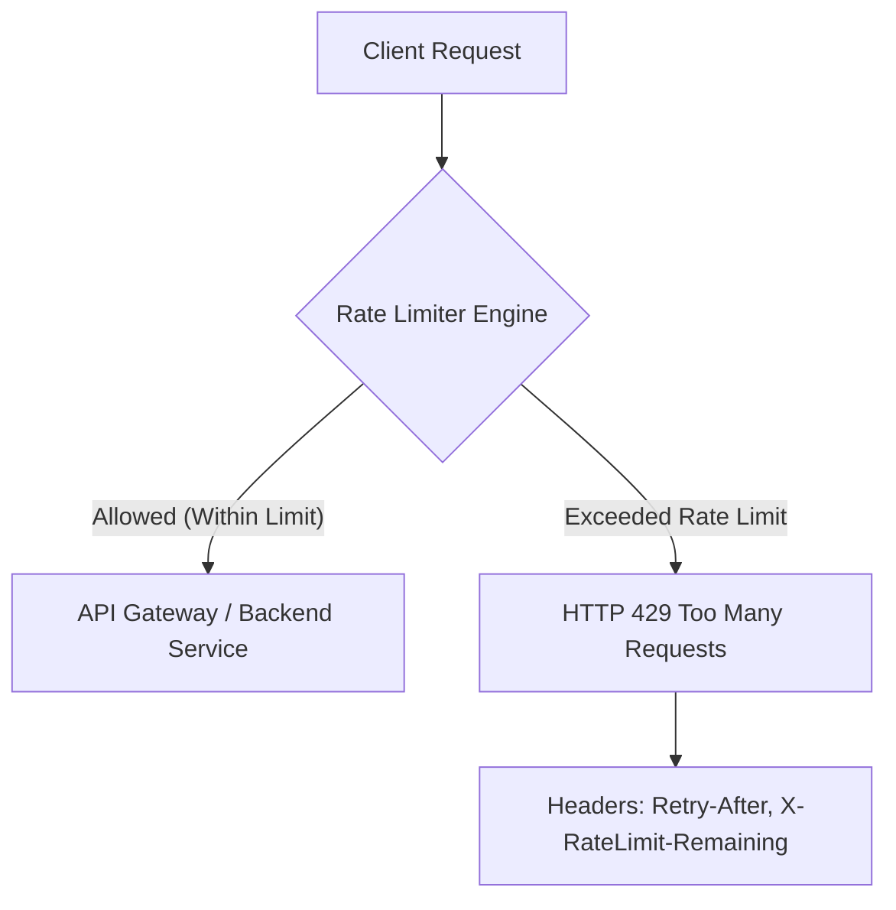
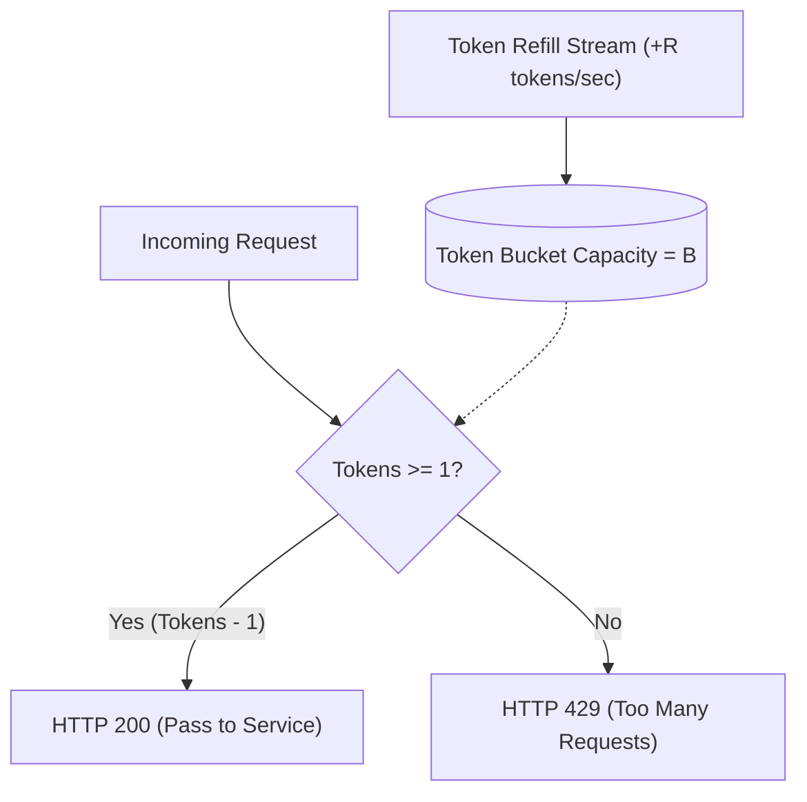
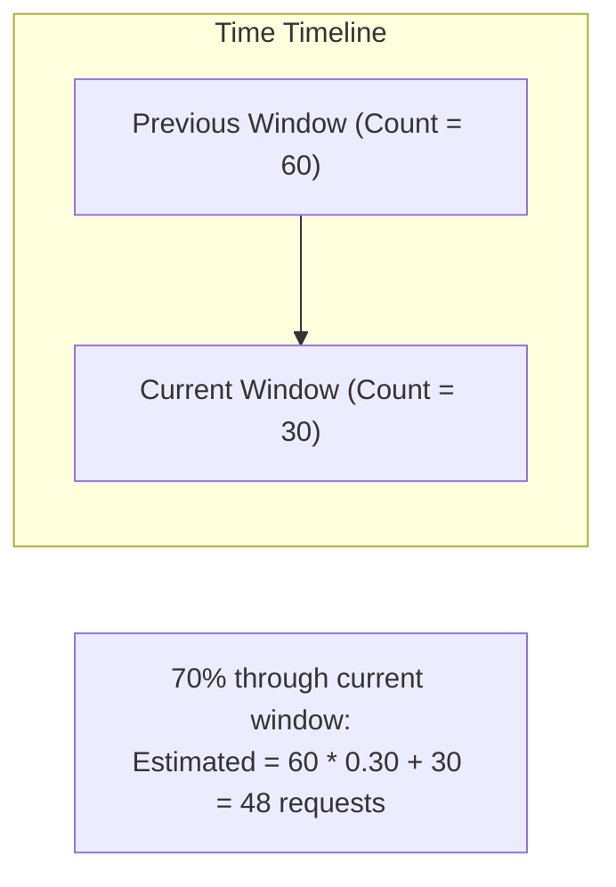

## TL;DR

- **Token Bucket**: Accumulates tokens at a constant rate up to capacity $B$. Requests consume tokens. **Allows controlled bursts**; memory footprint is $O(1)$. Industry standard for public APIs (AWS, Stripe).
- **Leaky Bucket**: Requests enter a FIFO queue and leak out at a constant rate. **Smoothes traffic** to a rigid cadence; rejects requests when queue overflows.
- **Fixed Window Counter**: Divides time into fixed intervals (e.g., 1 minute). Vulnerable to **2x boundary burst attacks** (e.g. 100 requests at 0:59, 100 requests at 1:01).
- **Sliding Window Log**: Stores timestamp of every request in a sorted set (e.g. Redis ZSET). Perfectly accurate, but **horrible $O(M)$ memory scaling** under high volume.
- **Sliding Window Counter**: Blends counts of previous window and current window proportionally. **Eliminates boundary bursts with $O(1)$ memory**.
- **GCRA (Generic Cell Rate Algorithm)**: Virtual scheduling algorithm that maintains a single integer timestamp (`TAT`). Memory efficient and mathematically equivalent to a leaky bucket without queue overhead.

---

## Why It Matters

Rate limiting is the first line of defense for web architectures. Unconstrained API endpoints expose systems to:
1. **Denial of Service (DoS / DDoS)**: Malicious or buggy clients saturating server CPU, memory, and database connection pools.
2. **Cascading Microservice Outages**: A slow downstream service causing upstream worker thread pool exhaustion.
3. **Resource Starvation & Noisy Neighbors**: In multi-tenant SaaS, one tenant monopolizing shared database bandwidth.
4. **Economic Attacks (Cost Exhaustion)**: Scraping LLM endpoints (OpenAI / Anthropic APIs) where each request incurs direct per-token cloud costs.

---

## Core Concepts & Mental Models

Every rate limiter defines three core parameters:
- **Rate ($R$)**: The sustained allowed request frequency (e.g., 100 requests per minute).
- **Burst Capacity ($B$)**: The maximum temporary burst permitted above the sustained rate.
- **Scope**: What defines a unique client (Client IP, User ID, API Key, Tenant ID, Endpoint path).



---

## Detailed Algorithm Internals & Visualizations

### 1. Token Bucket

A bucket holds up to $B$ tokens. Every $1/R$ seconds, a new token is added. When a request arrives:
- If tokens $\ge 1$, token is decremented and request is allowed.
- If tokens $< 1$, request is rejected with `HTTP 429`.



#### Lazy Refill Math (O(1) CPU)
Never run background tick timers to add tokens! Instead, compute tokens lazily upon each request:

$$\Delta t = t_{\text{current}} - t_{\text{last}}$$
$$\text{tokens}_{\text{current}} = \min(B, \text{tokens}_{\text{last}} + \Delta t \times R)$$

#### Redis Lua Implementation
```lua
-- KEYS[1]: rate_limit:user_id
-- ARGV[1]: capacity (B)
-- ARGV[2]: refill_rate_per_sec (R)
-- ARGV[3]: now (current unix timestamp in seconds)
-- ARGV[4]: requested_tokens (typically 1)

local key = KEYS[1]
local capacity = tonumber(ARGV[1])
local rate = tonumber(ARGV[2])
local now = tonumber(ARGV[3])
local requested = tonumber(ARGV[4])

local data = redis.call("HMGET", key, "tokens", "last_updated")
local tokens = tonumber(data[1])
local last_updated = tonumber(data[2])

if tokens == nil then
    tokens = capacity
    last_updated = now
else
    local delta = math.max(0, now - last_updated)
    tokens = math.min(capacity, tokens + delta * rate)
    last_updated = now
end

if tokens >= requested then
    tokens = tokens - requested
    redis.call("HMSET", key, "tokens", tokens, "last_updated", last_updated)
    redis.call("EXPIRE", key, math.ceil(capacity / rate) * 2)
    return 1 -- Allowed
else
    redis.call("HMSET", key, "tokens", tokens, "last_updated", last_updated)
    return 0 -- Rejected (429)
end
```

---

### 2. Leaky Bucket

A bucket with a constant-sized FIFO queue and a hole at the bottom.
- Requests enter the queue.
- If queue length $\ge B$, incoming requests are dropped.
- Requests leak out to the application at a constant rate $R$.
- **Key difference from Token Bucket**: Leaky bucket outputs a completely smooth traffic flow without any burstiness.

---

### 3. Fixed Window Counter

Divides time into discrete fixed slots (e.g., 01:00 to 01:01). A single counter tracks requests.

#### The 2x Boundary Burst Vulnerability:
If limit is **100 req/min**:
- Attacker sends 100 requests at `00:59`.
- New window starts at `01:00`.
- Attacker sends another 100 requests at `01:01`.
- **System experiences 200 requests in 2 seconds!** (2x the engineered limit).

---

### 4. Sliding Window Log

Stores the timestamp of every request in a sorted set (e.g., Redis `ZSET`).
1. Delete all timestamps older than `now - window_size` (`ZREMRANGEBYSCORE`).
2. Fetch current log size (`ZCARD`).
3. If count $< \text{limit}$, add current timestamp (`ZADD`) and allow request.
4. Else, reject.

> [!WARNING]
> **Memory Disaster**: Storing 100,000 requests in a Redis ZSET consumes ~8 MB per user! If 10,000 active users make requests, the rate limiter alone consumes 80 GB of RAM.

---

### 5. Sliding Window Counter (Hybrid Approximation)

Blends the previous window's count with the current window's count using a time-weighted formula:

$$\text{Weight}_{\text{prev}} = \frac{\text{window\_end} - t_{\text{current}}}{\text{window\_size}}$$
$$\text{Estimated Requests} = \text{Count}_{\text{prev}} \times \text{Weight}_{\text{prev}} + \text{Count}_{\text{current}}$$

Memory consumption is strictly **$O(1)$** (two 64-bit integers per client).



---

### 6. Generic Cell Rate Algorithm (GCRA)

Used heavily in telecommunications (ATM networks) and modern cloud proxies (Envoy, Rust's `governor` crate). It models rate limits using a single variable: **Theoretical Arrival Time (TAT)**.

- Each request has an emission interval $T = 1/R$.
- $TAT_{\text{new}} = \max(\text{now}, TAT_{\text{old}}) + T$.
- If $TAT_{\text{new}} - \text{now} > \text{Burst Tolerance } (\tau)$, reject request.

---

## Trade-offs Comparison Matrix

| Algorithm | Bursts Permitted | Memory Overhead | Time Complexity | Implementation Complexity | Boundary Spike Immune? |
| :--- | :--- | :--- | :--- | :--- | :--- |
| **Token Bucket** | **Yes** (up to $B$) | $O(1)$ | $O(1)$ | Low | Yes |
| **Leaky Bucket** | **No** (Smooths) | $O(B)$ | $O(1)$ | Medium | Yes |
| **Fixed Window** | **Yes** | $O(1)$ | $O(1)$ | Lowest | **No (2x Spike)** |
| **Sliding Window Log** | **No** | **$O(M)$ (High)** | $O(\log M)$ | Medium | Yes |
| **Sliding Window Counter** | Controlled | **$O(1)$** | $O(1)$ | Low | **Yes (Approximated)** |
| **GCRA** | Controlled | **$O(1)$** | $O(1)$ | Medium | Yes |

---

## Real-World Examples

- **Stripe API**: Uses Redis-backed Token Bucket per API key, returning `X-RateLimit-Limit`, `X-RateLimit-Remaining`, and `X-RateLimit-Reset` HTTP headers.
- **GitHub REST API**: Uses Sliding Window Counters allowing 5,000 requests per hour for authenticated users.
- **AWS API Gateway**: Implements Token Bucket where clients configure sustained rate (e.g. 10,000 rps) and burst limits (e.g. 5,000 rps).

---

## Worked Example: Capacity & Memory Sizing

Suppose an API Gateway handles:
- **100 Million Registered Users**
- **10 Million Daily Active Users (DAU)**
- Rate limit rule: **60 requests per minute** per user

### Memory Footprint Comparison:
1. **Sliding Window Log**:
   At 60 req/min, each user stores 60 timestamp entries. In Redis, each ZSET member takes ~64 bytes.
   $$\text{RAM per user} = 60 \times 64\text{ B} \approx 3.84\text{ KB}$$
   For 10M active users:
   $$\text{Total RAM} = 10,000,000 \times 3.84\text{ KB} \approx 38.4\text{ GB}$$
2. **Token Bucket / Sliding Window Counter**:
   Stores only two fields: `tokens` (int) and `last_updated` (timestamp) in a hash (~32 bytes):
   $$\text{Total RAM} = 10,000,000 \times 32\text{ B} \approx 320\text{ MB}$$
   *Token Bucket reduces RAM requirements by over 100x!*

---

## Pitfalls & Failure Modes in Production

1. **Race Conditions in Distributed Shards**:
   If an application executes `GET key` followed by `SET key`, concurrent requests from two app servers can both read `tokens = 1`, and both deduct a token, violating limits.
   - *Fix*: Always execute token modifications inside atomic **Redis Lua scripts** or use Redis `EVALSHA`.
2. **Clock Drift Between Cluster Nodes**:
   If Redis node A and Redis node B have physical clocks out of sync by 500ms, lazy refill calculations either grant free tokens or spuriously throttle users.
   - *Fix*: Use `redis.call("TIME")` within Lua scripts so the authoritative timestamp comes directly from the Redis server itself.
3. **Fail-Open vs Fail-Closed**:
   If the distributed Redis rate-limiter cluster crashes completely, should user requests be blocked (fail-closed) or allowed through (fail-open)?
   - *Rule*: Public payment/login endpoints fail-closed; general content feeds fail-open with local in-memory fallback throttling.

---

## Interview Corner

### [Basic] What HTTP status code and response headers should a rate limiter return?
**Model Answer**: It must return `HTTP 429 Too Many Requests`. Standard headers include:
- `Retry-After`: Number of seconds the client must wait before retrying.
- `RateLimit-Limit`: Maximum requests permitted per window.
- `RateLimit-Remaining`: Tokens or calls remaining in the current window.
- `RateLimit-Reset`: Unix timestamp when the quota completely resets.

### [Intermediate] How does Sliding Window Counter calculate request count without storing timestamps?
**Model Answer**: It tracks request counts in two fixed consecutive windows: the previous window and the current window. When a request arrives at timestamp $t$ which is, for example, 30% through the current 60-second window, it estimates traffic by multiplying the previous window's count by $0.70$ (the 70% overlap) and adding the current window's raw count. This eliminates boundary bursts with $O(1)$ memory.

### [Advanced] How do you handle rate limiting across multiple geographically distributed data centers?
**Model Answer**: Synchronizing every request globally across cross-region Redis clusters introduces 100ms+ round-trip latency. Production architectures use one of two approaches:
1. **Local Rate Limiting with Batch Sync**: Each data center has a local Redis cluster and is assigned a slice of the global limit (e.g. 3 regions each get 33% of limit). Local instances periodically sync usage asynchronously via Kafka or Gossip.
2. **Token Reservation**: Edge gateways request token grants (e.g. 50 tokens at a time) from a central coordinator and spend them locally, renewing before exhaustion.

### [Basic] What is the difference between a rate limit and a quota?
**Model Answer**: A **rate limit** enforces short-term burst protection and traffic shaping (e.g., 100 requests per second or 1,000 requests per minute) to protect infrastructure stability. A **quota** enforces long-term business or billing constraints (e.g., 1,000,000 API calls per month, or 10 GB bandwidth per billing cycle). When a rate limit is exceeded, clients wait and retry (`Retry-After: 5`); when a quota is exceeded, clients are typically blocked until the next billing cycle or forced to upgrade their tier.

### [Intermediate] How do you implement cost-based or token-based rate limiting for LLM APIs?
**Model Answer**: Standard rate limiters decrement 1 token per HTTP request. In LLM APIs, a prompt requesting 50 tokens consumes trivial compute, while a prompt requesting 8,000 tokens consumes massive GPU KV-cache memory and compute time.
- *Implementation*:
  1. The client sends the payload; the gateway estimates prompt tokens using a fast tokenizer (e.g., `tiktoken` in Rust/Go) plus requested `max_tokens`.
  2. Decrement the Token Bucket by the estimated token count (e.g., 2,500 tokens).
  3. If bucket drops below zero, reject with HTTP 429.
  4. Upon LLM response completion, reconcile the bucket with the actual tokens reported in `usage.total_tokens` (refund unspent tokens or charge overages).

### [Advanced] How do you prevent attackers from bypassing IP-based rate limiting?
**Model Answer**: Attackers use residential proxies or VPNs to rotate IP addresses. Mitigation requires multi-tiered composite keys:
1. Combine IP with HTTP request fingerprinting (JA3/JA4 TLS fingerprints, HTTP header ordering).
2. Authenticated endpoints rate-limit strictly by authenticated User ID or API Key rather than IP.
3. Layer Proof-of-Work or Cloudflare Turnstile / CAPTCHAs when suspicious IP subnets trigger threshold warnings.

---

## Cheat Sheet & Key Takeaways

- **Default Choice for Public APIs**: **Token Bucket** (flexible, permits bursts, $O(1)$ memory).
- **Default Choice for Predictable Stream Ingestion**: **Leaky Bucket** (constant drain rate).
- **Default for Distributed Gateways without Queueing**: **Sliding Window Counter** or **GCRA**.
- **Always use Redis Lua** to make check-and-decrement operations atomic.
