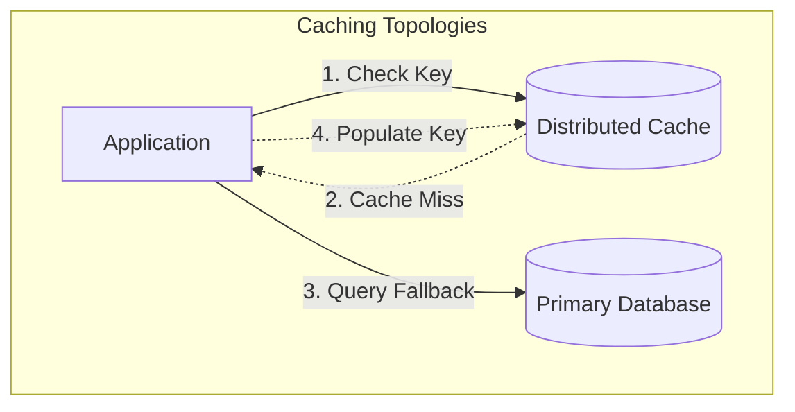
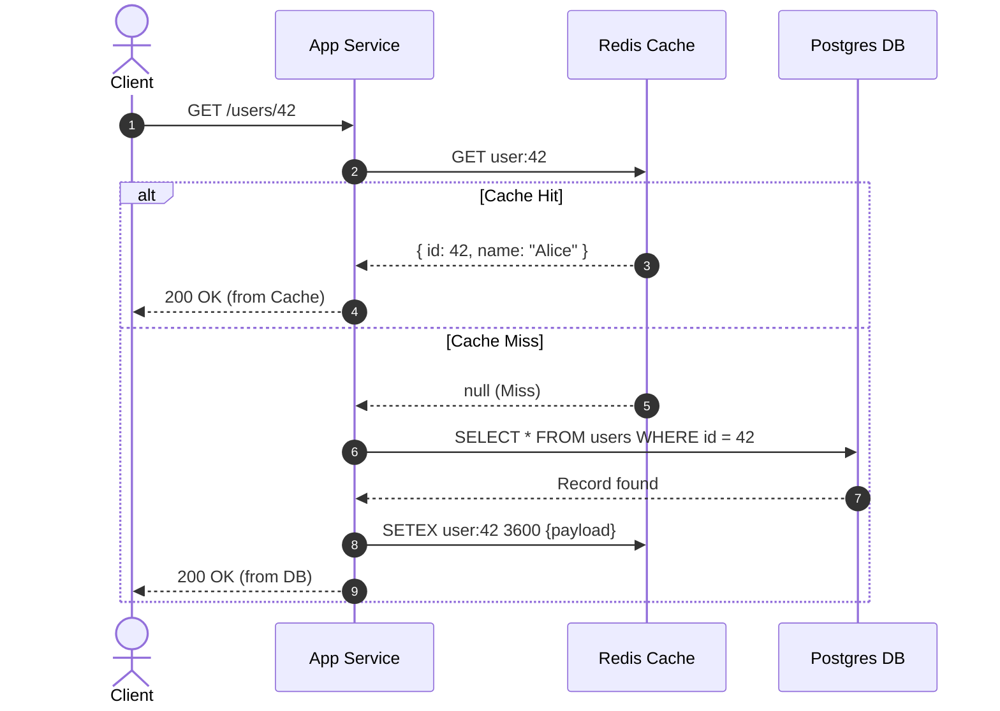
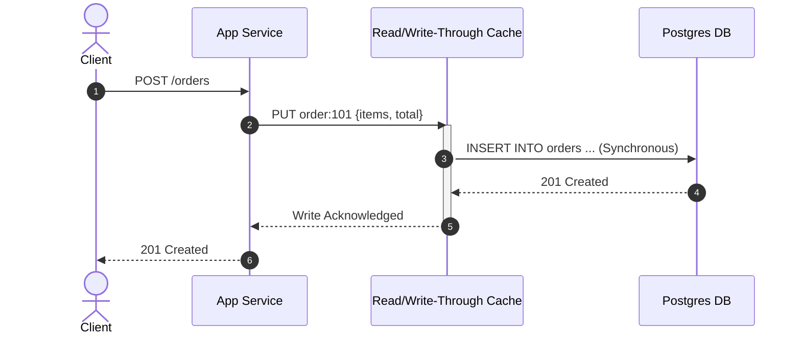
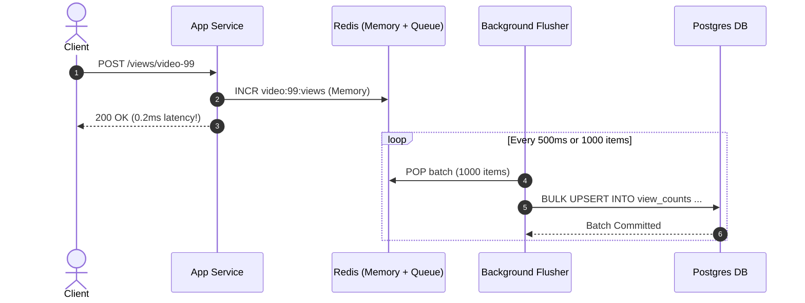

## TL;DR

- **Cache-Aside (Lazy Loading)**: Application code explicitly reads from cache; on miss, queries the database, writes result into cache, and returns. Most popular and resilient.
- **Read-Through**: Application treats cache as the primary data store; the cache library/framework transparently loads missing items from the database.
- **Write-Through**: Application writes to cache; cache synchronously writes to the database in the same transaction before acknowledging the caller. Highest read-after-write consistency, higher write latency.
- **Write-Behind (Write-Back)**: Application writes to cache and receives an instant 200 OK; cache batches and asynchronously flushes writes to the database. Extreme write throughput, risk of data loss on cache node crash.
- **Write-Around**: Writes bypass cache directly to database; cache is only populated on subsequent reads. Prevents cache pollution from write-heavy, rarely-read records.
- **The Golden Rule for Updates**: **Update database first, then delete (invalidate) the cache key**. Never update cache directly after DB write due to out-of-order concurrent race conditions.

---

## Why It Matters

In high-scale systems, persistent relational or document databases are fundamentally bound by disk I/O, lock contention, and connection limits (typically 2,000–10,000 QPS per instance). An in-memory distributed cache like Redis or Memcached serves 100,000+ QPS per core with sub-millisecond latencies (~100µs vs 5–25ms DB lookups).

However, introducing a secondary storage tier immediately introduces the **dual-write problem**: two independent distributed systems (Cache + Database) must be kept synchronized without distributed locks or 2PC slowing down every request. Choosing the wrong caching strategy results in stale data, lost updates, cache stampedes, or memory exhaustion.

---

## Core Concepts & Mental Models

Caching patterns differ across two orthogonal axes:
1. **Control Flow (Who coordinates the DB?)**: Does the application coordinate the DB (Cache-Aside), or does a caching abstraction layer encapsulate the DB (Read/Write-Through)?
2. **Write Timing (When does data reach persistent disk?)**: Synchronously on write (Write-Through), asynchronously batched (Write-Behind), or only on read-miss (Write-Around)?

---

## How It Works: Step-by-Step Internals

### 1. Cache-Aside (Lazy Loading)

Cache-Aside is the de facto standard in web microservices. The application code manages the coordination.

#### The Cache-Aside Invalidation Protocol
When updating a record, should you **Update Cache** or **Delete Cache**?
> [!IMPORTANT]
> **Always DELETE the cache key after writing to the database.**
> If Thread A and Thread B update the database concurrently:
> 1. Thread A writes DB (val = 1)
> 2. Thread B writes DB (val = 2)
> 3. Due to network delays, Thread B updates Cache (val = 2)
> 4. Thread A's delayed packet arrives and updates Cache (val = 1)
> 
> Result: Database has val = 2, but Cache permanently holds stale val = 1!
> Deleting the key avoids this entirely, forcing the next read to fetch the latest DB state.

---

### 2. Read-Through & Write-Through

In Read-Through / Write-Through, the application treats the caching tier as the sole data store. The cache itself implements a storage plugin (like a Redis Gear, DAX for DynamoDB, or Hazelcast store) that handles persistence.

---

### 3. Write-Behind (Write-Back)

In Write-Behind, writes are immediately acknowledged once committed to the in-memory cache. A background worker periodically drains an in-memory queue or WAL, batching writes into bulk SQL `INSERT ... ON CONFLICT` operations.

---

### 4. Write-Around

Data is written directly to the database, skipping the cache entirely. The cache is only populated when a subsequent read encounters a cache miss.

---

## Variants and Sub-Topics

### CDC-Driven Asynchronous Invalidation
In ultra-high scale architectures (e.g. Netflix, Meta), having application servers directly delete cache keys creates small windows where replica read lag can repopulate the cache with stale data. Instead, services rely on **Change Data Capture (CDC)**:
1. App writes to Primary DB.
2. DB writes to Write-Ahead Log (WAL).
3. Debezium reads WAL and streams row change events to Kafka.
4. A dedicated Invalidator consumer reads Kafka and purges affected Redis keys.

---

## Trade-offs Table

| Strategy | Read Latency | Write Latency | Consistency | Complexity | Risk of Data Loss |
| :--- | :--- | :--- | :--- | :--- | :--- |
| **Cache-Aside** | Low (on hit) | Normal DB speed | Eventual (requires explicit delete) | Low | **Zero** |
| **Read-Through** | Low (on hit) | Normal | High | Medium (custom plugin) | **Zero** |
| **Write-Through** | Lowest (always warm) | Higher (DB + Cache) | High (synchronized) | Medium | **Zero** |
| **Write-Behind** | Lowest | Sub-millisecond | Eventual | High | **High** (if cache crashes before flush) |
| **Write-Around** | Higher on first read | Normal DB speed | High | Lowest | **Zero** |

---

## Real-World Examples

- **Stripe**: Uses Cache-Aside with Redis for merchant API keys and idempotency records, enforcing explicit key invalidation with strict TTL jitter to prevent thundering herds.
- **Instagram**: Uses Memcached with Cache-Aside in front of sharded PostgreSQL. Uses Facebook's `mcrouter` connection pooler to implement lease tokens that prevent stale overwrites.
- **Discord**: Uses Write-Behind for guild channel read states and message acknowledgement tracking, batching millions of ephemeral updates before persisting to ScyllaDB.

---

## Worked Example: Capacity & Memory Math

Suppose an e-commerce platform has:
- **10 Million Products** in catalog.
- Each product record payload: **2 KB**.
- **80/20 Rule**: 20% of products generate 80% of read traffic.
- Traffic: **25,000 Read QPS**, **500 Write QPS**.

### Calculations:
1. **Total Catalog Storage**:
   $$\text{Total Data} = 10,000,000 \times 2\text{ KB} = 20,000,000\text{ KB} \approx 20\text{ GB}$$
2. **Working Set Memory (80/20 Cache)**:
   $$\text{Hot Cache Size} = 20\% \times 20\text{ GB} = 4\text{ GB}$$
3. **RAM Sizing with Overhead**:
   Add 30% for Redis memory fragmentation, hash table pointers, and replication buffers:
   $$\text{Provisioned RAM} = 4\text{ GB} \times 1.30 \approx 5.2\text{ GB}$$
4. **Bandwidth Savings**:
   At 25,000 QPS with an 85% cache hit ratio:
   - Queries saved from Postgres: $25,000 \times 0.85 = 21,250\text{ QPS}$
   - Database only handles: $3,750\text{ read QPS} + 500\text{ write QPS} = 4,250\text{ QPS}$ (easily served by a single DB replica!).

---

## Pitfalls, Anti-Patterns & Failure Modes

1. **Cache Stampede (Dogpile Effect)**: When a heavily requested key (e.g. homepage banner) expires, hundreds of concurrent threads get a cache miss simultaneously and hammer the database.
   - *Mitigation*: Use singleflight / request coalescing, mutex locks, or probabilistic early recomputation (XFetch algorithm).
2. **Cache Penetration**: Malicious clients query non-existent keys (e.g. `id = -999999`). Every request bypasses the cache and hits the database.
   - *Mitigation*: Cache null values with short TTL (e.g. 30s) or place a **Bloom filter** in front of the cache.
3. **Cache Avalanche**: Hundreds of thousands of keys set with the exact same 1-hour TTL expire simultaneously, shifting all traffic to the DB.
   - *Mitigation*: Add random jitter to all TTLs: `TTL = base_ttl + rand(-180, 180)`.

---

## Interview Corner

### [Basic] What is the difference between Cache-Aside and Write-Through?
**Model Answer**: In Cache-Aside, the application code directly orchestrates caching: it queries the cache first, handles misses by reading the DB, and populates the cache. In Write-Through, the application only talks to the cache abstraction; the cache itself synchronously updates the database in the same transaction before returning success.
- *Follow-up*: What happens if the database write fails in Write-Through? The entire transaction fails and the cache entry is rolled back.

### [Intermediate] Why should you delete a cache key on update rather than updating it?
**Model Answer**: Updating the cache creates a race condition with concurrent writes. If Client A writes DB, then Client B writes DB, but Client B's cache update executes *before* Client A's delayed cache update arrives, the cache will hold Client A's stale value indefinitely. Deleting the key ensures that the next read retrieves the authoritative value from the database.
- *Follow-up*: Can deleting the key also cause a race condition? Yes, if a concurrent read reads stale DB data between the write and the delete, then writes that stale data back to cache. This is mitigated by setting a TTL or using Redis delete with delayed double deletion.

### [Advanced] How do you handle cache consistency when using Read Replicas?
**Model Answer**: When the primary database receives a write and the application immediately deletes the cache key, a concurrent read may miss cache and query a *read replica* that has replication lag (e.g. 50ms behind). The replica returns old data, and the reader re-populates the cache with stale data.
- *Mitigation*:
  1. **Delayed Double Delete**: Delete the cache key, write to DB, wait 500ms (covering max replication lag), and delete the key again.
  2. **CDC Invalidation**: Purge cache only from the replica's binlog stream after it confirms replication.
  3. **Read-Your-Own-Writes Token**: Route user reads to Primary DB for 2 seconds after an update.

### [Intermediate] How do you prevent cache stampedes (thundering herd) when a high-traffic key expires?
**Model Answer**: When a popular key expires, hundreds of concurrent requests simultaneously miss the cache and hit the database.
- *Mitigations*:
  1. **Mutex / Singleflight (Request Coalescing)**: Only the first thread that misses the cache acquires a distributed lock (or process-local mutex) to query the DB and repopulate the cache. All other threads wait for the lock or poll the cache.
  2. **Pre-fetching / Refresh-Ahead**: A background cron or worker refreshes the cache entry at 80% of its TTL before expiration.
  3. **Probabilistic Early Expiration (XFetch)**: Compute an early refresh probability so one random client recomputes the cache slightly before true expiration.

### [Advanced] What is the XFetch algorithm for probabilistic early cache expiration?
**Model Answer**: XFetch calculates a dynamic recomputation condition:
$$-\beta \times \delta \times \ln(\text{rand}()) > \text{remaining\_TTL}$$
Where $\beta > 0$ is an aggressiveness factor, $\delta$ is the delta computation time to query the DB, and $\text{rand}() \in (0, 1]$. As the key approaches expiration, the probability that an incoming read worker asynchronously recomputes the value approaches 1.0, guaranteeing that the key is refreshed before it expires while ensuring only one worker executes the query.

### [Advanced] How would you architect Write-Behind so that no data is lost during server crashes?
**Model Answer**: Pure in-memory queues lose data if the process crashes. To make Write-Behind crash-resilient:
1. Append writes to a local or distributed write-ahead log (e.g. Kafka or Redis Streams with AOF `appendfsync everysec`).
2. Have idempotent consumer workers batch writes into the database.
3. Acknowledge the offset only after the database bulk transaction commits.

---

## Cheat Sheet & Key Takeaways

- **Default Choice**: Use **Cache-Aside** with **Delete on Update** and random **TTL jitter**.
- **For High Write Volumes (Counters/Analytics)**: Use **Write-Behind** with persistent stream backing.
- **For Cold Records / Bulk Ingestion**: Use **Write-Around** to prevent evicting hot working sets.
- **Always implement**: Jittered TTLs, Singleflight request coalescing, and Null caching / Bloom filters.
