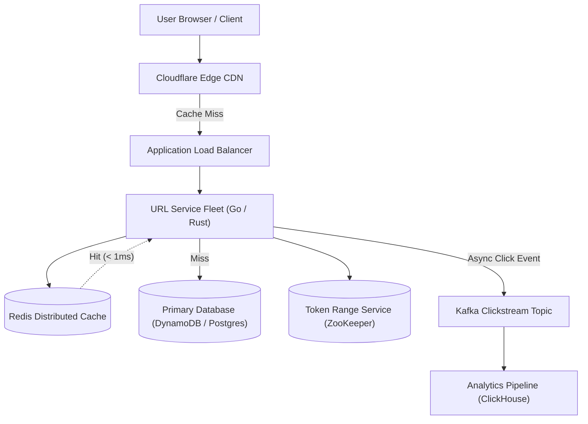
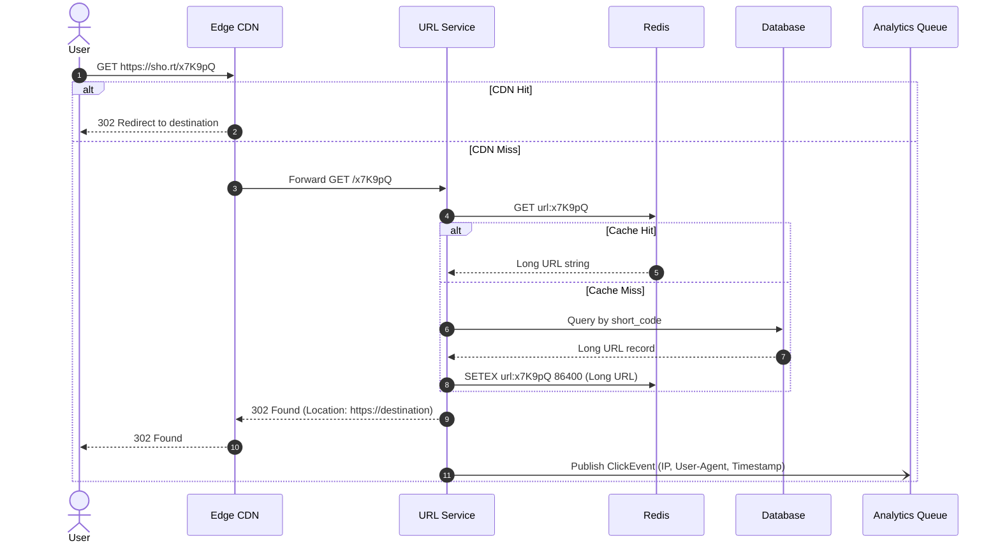

## 1. Problem Statement & Clarifying Questions

Design a scalable URL shortening service like Bitly or TinyURL that takes long URLs (e.g. `https://example.com/long/deep/path?ref=123`) and generates short, unique aliases (e.g. `https://sho.rt/aB3x9Z`). When users navigate to the alias, they are redirected to the destination URL.

### Clarifying Questions & Assumed Answers
1. **What is the read-to-write ratio?**
   *Answer*: Read-heavy system. Approximately **100:1** read-to-write ratio.
2. **What is the traffic volume?**
   *Answer*: **100 Million new URLs created per month**, and **10 Billion redirects per month**.
3. **What is the default retention period?**
   *Answer*: URLs must be retained for **5 years** by default unless custom TTL is specified.
4. **Can users specify custom vanity URLs?**
   *Answer*: Yes, users can supply custom short aliases (e.g. `/my-cool-link`) up to 16 characters.
5. **What are the latency expectations?**
   *Answer*: Redirect latency must be **sub-10ms** (p99). Creation latency **sub-50ms**.

---

## 2. Requirements & Scope Boundaries

### Functional Requirements
1. **URL Shortening**: Given a long URL, generate a unique, short alias (maximum 7 alphanumeric characters).
2. **Redirection**: Given a short alias, redirect the HTTP client to the original long URL with minimum latency.
3. **Custom Aliases**: Allow users to define custom short URLs if not already taken.
4. **URL Expiration**: Support optional expiration dates (TTL).
5. **Analytics**: Track total click counts, referral sources, and geographic distribution.

### Non-Functional Requirements
1. **High Availability**: 99.99% uptime (four nines); redirect service must never go down.
2. **Ultra-Low Latency**: Redirects must complete in under **10ms** via globally distributed caching.
3. **High Durability**: A committed URL must never be lost.
4. **Non-Predictability**: Short URL tokens must not be easily sequential to prevent web scraping attacks.

### Explicitly Out-of-Scope
- User billing and enterprise subscription tiers.
- Link preview crawling or dynamic screenshot generation.

---

## 3. Capacity Estimation (Back-of-the-Envelope Math)

### Traffic & Throughput Math
- **New URLs created**: $100\text{ Million} / \text{month}$
  $$\text{Write QPS} = \frac{100,000,000}{30 \times 86,400} \approx 38.6\text{ writes/sec}$$
  $$\text{Peak Write QPS (3x)} \approx 120\text{ writes/sec}$$
- **Redirection Reads (100:1 ratio)**:
  $$\text{Read QPS} = 38.6 \times 100 \approx 3,860\text{ reads/sec}$$
  $$\text{Peak Read QPS (3x)} \approx 11,500\text{ reads/sec}$$

### Storage Math (5-Year Retention)
- Total URLs stored over 5 years:
  $$100\text{ Million/month} \times 12\text{ months} \times 5\text{ years} = 6\text{ Billion URLs}$$
- Payload per URL record:
  - `id`: 8 bytes (int64)
  - `short_code`: 7 bytes (ASCII)
  - `long_url`: 500 bytes (average)
  - `created_at`: 8 bytes
  - `expires_at`: 8 bytes
  - `user_id`: 16 bytes (UUID)
  - Metadata overhead: ~50 bytes
  - **Total per record**: $\approx 600\text{ bytes}$
- 5-Year Database Storage:
  $$6\text{ Billion} \times 600\text{ Bytes} \approx 3.6\text{ TB}$$
  With 3x replication factor: $3.6\text{ TB} \times 3 \approx 10.8\text{ TB}$ (easily manageable).

### Network Bandwidth Math
- **Ingress**: $120\text{ writes/sec} \times 600\text{ B} \approx 72\text{ KB/s}$ (negligible)
- **Egress**: $11,500\text{ reads/sec} \times 600\text{ B} \approx 6.9\text{ MB/s}$

### Cache Sizing (80/20 Rule)
- 20% of URLs generate 80% of daily redirects:
  $$\text{Daily Reads} = 3,860 \times 86,400 \approx 333\text{ Million reads/day}$$
  $$\text{Daily Unique URLs Accessed (approx)} \approx 33\text{ Million}$$
  $$\text{Cache 20\%} = 33\text{ Million} \times 0.20 \times 600\text{ Bytes} \approx 3.96\text{ GB RAM}$$
  *A single Redis node with 16 GB RAM easily caches 4x the daily working set!*

---

## 4. API Design

### 1. Create Short URL
```http
POST /api/v1/urls
Content-Type: application/json
Idempotency-Key: 7b9f-41a2-89c0

{
  "long_url": "https://en.wikipedia.org/wiki/Distributed_computing",
  "custom_alias": "dist-sys-wiki",
  "expires_in_days": 365
}
```
**Response: `201 Created`**
```json
{
  "short_url": "https://sho.rt/dist-sys-wiki",
  "long_url": "https://en.wikipedia.org/wiki/Distributed_computing",
  "created_at": "2026-10-25T12:00:00Z",
  "expires_at": "2027-10-25T12:00:00Z"
}
```

### 2. Redirect Endpoint
```http
GET /{short_code}
```
**Response: `302 Found`**
```http
HTTP/1.1 302 Found
Location: https://en.wikipedia.org/wiki/Distributed_computing
Cache-Control: no-cache, no-store
```

> [!TIP]
> **HTTP 301 vs 302 Decision**:
> - `301 Moved Permanently`: The browser aggressively caches the destination locally. Subsequent clicks bypass your servers, making click-tracking analytics impossible.
> - `302 Found (Temporary)`: The browser asks your shortener on every redirect, allowing accurate real-time click counting, referrers, and geo-analytics.

---

## 5. Data Model & Database Selection

### Schema Design
```sql
CREATE TABLE urls (
    id BIGINT PRIMARY KEY,
    short_code VARCHAR(16) NOT NULL UNIQUE,
    long_url VARCHAR(2048) NOT NULL,
    user_id UUID,
    created_at TIMESTAMP WITH TIME ZONE DEFAULT NOW(),
    expires_at TIMESTAMP WITH TIME ZONE,
    click_count BIGINT DEFAULT 0
);

CREATE INDEX idx_urls_short_code ON urls(short_code);
```

### Database Choice: NoSQL (DynamoDB / Cassandra) vs Relational (PostgreSQL)
- **Selected Choice**: **Amazon DynamoDB** or **MongoDB / PostgreSQL with Read Replicas**.
- **Justification**: The access pattern is 99% single-key point lookups (`WHERE short_code = ?`). There are no relational joins or foreign-key constraints. DynamoDB provides single-digit millisecond latency at any horizontal scale with zero operations overhead.

---

## 6. High-Level Architecture & Sequence Diagrams



### Main Redirection Flow


---

## 7. Deep Dives into the Hardest Parts

### Deep Dive 1: Generating Short Tokens (Base62 Encoding)
To store 6 Billion URLs, how many characters do we need?
Using Base62 characters (`[0-9, a-z, A-Z]`):
- 6 characters: $62^6 \approx 56.8\text{ Billion}$ combinations.
- 7 characters: $62^7 \approx 3.52\text{ Trillion}$ combinations.
*7 characters provides centuries of headroom.*

#### Why MD5/SHA-256 Hashing Fails:
Computing `MD5(long_url)` generates a 128-bit hash. Taking the first 7 characters causes **hash collisions** under the Birthday Paradox after ~200,000 URLs. Handling collisions via linear probing requires repeated database lookups.

#### The Winner: Distributed Key Generation Service (Range Allocation)
1. Maintain an atomic distributed counter (int64).
2. A central coordinator (ZooKeeper) assigns non-overlapping ranges of 1,000,000 numbers to each application server:
   - Server 1 gets IDs `[1,000,000 to 1,999,999]`
   - Server 2 gets IDs `[2,000,000 to 2,999,999]`
3. Each server increments its local atomic counter in memory without locking any database.
4. Convert the 64-bit integer into Base62:

```typescript
const BASE62_CHARS = "0123456789abcdefghijklmnopqrstuvwxyzABCDEFGHIJKLMNOPQRSTUVWXYZ";

export function encodeBase62(num: bigint): string {
  if (num === 0n) return BASE62_CHARS[0];
  let result = "";
  let current = num;
  while (current > 0n) {
    const remainder = Number(current % 62n);
    result = BASE62_CHARS[remainder] + result;
    current = current / 62n;
  }
  return result.padStart(7, "0");
}
```

---

## 8. Scaling Evolution Path

- **v1 (MVP - 1k QPS)**: Single Node.js server + PostgreSQL on AWS RDS + Local LRU cache.
- **v10 (10x Scale - 10k QPS)**: Stateless application containers on AWS ECS/Fargate + Redis cluster for top 20% URLs + PostgreSQL Read Replicas.
- **v100 (100x Scale - 100k+ QPS)**:
  - Anycast GeoDNS routing requests to the closest geographic region.
  - Cloudflare Edge CDN caching 302 redirects with a 60-second TTL.
  - Multi-region DynamoDB with Global Tables.
  - Asynchronous analytics aggregation via Kafka and ClickHouse.

---

## 9. Bottlenecks & Failure Modes

1. **Hot Key Stampede (Celebrity URL)**:
   A popular tweet contains a short URL generating 50,000 clicks/sec.
   - *Mitigation*: Edge CDN caching + local in-memory LRU in each app container with Singleflight request coalescing.
2. **Key Generation Service (KGS) Failure**:
   If a server crashes, its allocated range of 1M IDs is discarded (gaps in ID space are completely acceptable and do not impact functionality).
3. **Malicious Phishing / Malware Links**:
   Attackers shorten malware links to bypass security filters.
   - *Mitigation*: Run asynchronous URL reputation checks via Google Safe Browsing API before activating the short URL.

---

## 10. Cross-Cutting Concerns

- **Observability**: Track p50, p95, and p99 redirect latencies, cache hit ratio (alert if $< 80\%$), and 404 rate.
- **Security**: Rate limit link creation to 20 URLs/minute per IP using Token Bucket to block link spam.

---

## 11. Trade-offs & Alternatives Considered

- **Base62 vs Base64**: Base64 contains `+` and `/` which are reserved URL delimiters and require URL encoding (`%2B`). Base62 is 100% URL-safe.
- **Pre-generating tokens vs On-the-fly Base62**: Pre-generating tokens in a table adds unnecessary batch background job complexity. Converting in-memory range counters to Base62 is $O(1)$ and requires zero database round-trips.

---

## 12. Concepts Used

- [Back-of-the-Envelope Estimation](file:///foundations/back-of-envelope-estimation)
- [Caching Strategies](file:///caching/caching-strategies)
- [Rate Limiting Algorithms](file:///api-design/rate-limiting-algorithms)

---

## 13. Interview Corner & Follow-ups

### [Basic] Why is Base62 chosen over hexadecimal or Base64?
**Model Answer**: Hexadecimal only has 16 characters (0-9, a-f), requiring 10 characters to represent 1 Trillion IDs. Base64 has 64 characters but includes `+` and `/` which break URL query parameters. Base62 consists exclusively of alphanumeric `[0-9, a-z, A-Z]`, providing optimal density while remaining completely URL-safe.

### [Basic] How do you handle custom vanity URLs?
**Model Answer**: When a user specifies a custom alias, check if it already exists in the database. If not, insert it directly. To prevent collisions with the auto-generated numeric IDs, either prefix custom aliases with an underscore or reserve a minimum character length (e.g. custom aliases must be $\ge 8$ chars while auto-generated are 7 chars).

### [Intermediate] What happens if the same long URL is submitted twice?
**Model Answer**: There are two valid design trade-offs:
1. *Deduplication*: Hash the long URL, return the existing short code. Saves storage, but violates privacy if users expect separate click analytics.
2. *Always New*: Issue a unique short code every time. Preferred in production because different marketing campaigns require independent attribution metrics.

### [Intermediate] How do you expire old URLs automatically?
**Model Answer**: Rather than running slow periodic `DELETE` table scans, use a lazy expiration pattern:
1. When a user requests a short URL, check if `now() > expires_at`. If expired, return HTTP 404 and trigger asynchronous deletion.
2. If using DynamoDB, configure native TTL attributes so AWS automatically cleans up expired items in the background at zero read unit cost.

### [Advanced] How would you design the distributed analytics pipeline for click metrics?
**Model Answer**: Never increment click counters directly in the primary transactional database on every redirect; doing so turns a read-heavy system into a write-bottlenecked one. Instead:
1. Application servers emit an asynchronous `ClickEvent` (short_code, timestamp, IP, User-Agent, Referrer) to an Apache Kafka topic.
2. Flink or Spark Streaming consumes events in tumbling 1-minute windows.
3. Aggregated counts are written into ClickHouse or TimescaleDB for sub-second analytical dashboard queries.

### [Advanced] How do you prevent attackers from guessing sequential short URLs?
**Model Answer**: Pure incremental IDs (`1, 2, 3`) map to sequential short codes (`0000001, 0000002`), allowing bots to scrape all shortened URLs. To prevent this:
1. Feed the 64-bit integer through a Feistel cipher or multiplicative inverse function before Base62 encoding.
2. This creates pseudo-random diffusion: integer `1` produces `k9X1mQ`, and integer `2` produces `v3B8rL`, while remaining 100% reversible and collision-free.

### [Advanced] How do you protect against cache penetration from non-existent short codes?
**Model Answer**: If bots query millions of random non-existent short codes (e.g. `/aaaaaaa`, `/aaaaaab`), every query bypasses the cache and hits the database.
- *Mitigation*: Maintain a **Bloom filter** in front of the cache. If the Bloom filter returns `false`, return HTTP 404 immediately without touching Redis or the database.

### [Advanced] How do you migrate to 8-character tokens when 7-character combinations are exhausted?
**Model Answer**: The Base62 encoder can detect when counter exceeds $62^7 - 1$ and begin emitting 8-character tokens. Because routing is a direct key-value lookup, length changes do not require database schema alterations or migrations.
