## TL;DR

Back-of-the-envelope estimation is the art of using mental arithmetic and order-of-magnitude approximations to evaluate architectural viability:
- **1 Day in Seconds**: $86,400 \approx 100,000$ ($10^5$) seconds for mental math, or $8.64 \times 10^4$ for accuracy.
- **Conversion Shortcut**: $1\text{ Million requests/day} \approx 12\text{ QPS}$ average ($10^6 / 86,400$). Peak is typically $2\times$ to $5\times$ average ($\approx 25\text{ to } 60\text{ QPS}$).
- **Powers of Two & Data Sizes**: $2^{10} \approx 1\text{ KB} (10^3)$, $2^{20} \approx 1\text{ MB} (10^6)$, $2^{30} \approx 1\text{ GB} (10^9)$, $2^{40} \approx 1\text{ TB} (10^{12})$, $2^{50} \approx 1\text{ PB} (10^{15})$.
- **Memory vs Disk Latency**: Reading 1 MB sequentially from RAM takes $\approx 250\ \mu\text{s}$; reading 1 MB from SSD takes $\approx 1\text{ ms}$ ($4\times$ slower); reading 1 MB from spinning HDD takes $\approx 20\text{ ms}$ ($80\times$ slower).
- **Network Round-Trip Time (RTT)**: Intra-datacenter $\approx 0.5\text{ ms}$; US cross-country (CA to NY) $\approx 60\text{ ms}$; Transatlantic (NY to London) $\approx 150\text{ ms}$.
- **80/20 Pareto Rule for Caching**: Cache the top 20% of active daily content to serve 80% of read queries from in-memory RAM.

---

## Why It Matters

In a system design interview, an architecture diagram without capacity numbers is just hand-waving. Estimation answers critical architectural forks:
1. **Database Selection**: Can a single PostgreSQL primary handle our write volume, or do we need Cassandra / DynamoDB? (PostgreSQL handles $\approx 5,000\text{ to } 10,000$ write QPS per node; if write QPS is 50,000, sharding or NoSQL is required).
2. **Storage Sizing**: Do we need 500 GB per year (trivial, single disk) or 5 Petabytes per year (distributed object store with tiered lifecycle policies)?
3. **Bandwidth Costs**: Will egress bandwidth bankrupt the company? (e.g., 100 Gbps streaming requires multi-CDN peering).
4. **Cache Feasibility**: Can the working set fit into a single Redis instance (64 GB RAM), or do we need a 32-node distributed cluster?

---

## Core Concepts & Mental Models

### The Hardware Latency Hierarchy

```mermaid
graph LR
    subgraph Nano["Nanoseconds (CPU & Memory)"]
        L1["L1 Cache: 0.5 ns"]
        L2["L2 Cache: 7 ns"]
        RAM["Main Memory (RAM): 100 ns"]
    end

    subgraph Micro["Microseconds (Fast Storage & Local Network)"]
        SSD_R["SSD Random Read: 16 µs"]
        RAM_SEQ["Read 1MB from RAM: 250 µs"]
        DC_RTT["Datacenter Round Trip: 500 µs"]
    end

    subgraph Milli["Milliseconds (Disk & Global Internet)"]
        SSD_SEQ["Read 1MB from SSD: 1 ms"]
        HDD_SEEK["Disk Seek: 10 ms"]
        HDD_SEQ["Read 1MB from Disk: 20 ms"]
        TRANS_RTT["Transatlantic RTT: 150 ms"]
    end

    Nano --> Micro --> Milli
```



### Numerical Equivalents Cheat Sheet

```
+-----------+--------------+------------+-------------------------------------+
| Power     | Exact Bytes  | Approx     | System Design Equivalent            |
+-----------+--------------+------------+-------------------------------------+
| 2^10      | 1,024 B      | 1 KB (10^3)| Short user profile JSON or tweet    |
| 2^20      | 1,048,576 B  | 1 MB (10^6)| High-res photo or short PDF         |
| 2^30      | 1,073,741,824| 1 GB (10^9)| 1 hour of compressed 1080p video    |
| 2^40      | 1.099 x 10^12| 1 TB (10^12| Daily clickstream logs of mid app   |
| 2^50      | 1.125 x 10^15| 1 PB (10^15| YouTube daily ingestion archive     |
+-----------+--------------+------------+-------------------------------------+
```

---

## The 4 Core Estimation Formulas

### 1. Throughput (QPS) Formula

$$\text{Average QPS} = \frac{\text{Daily Active Users (DAU)} \times \text{Requests per User per Day}}{86,400\text{ seconds}}$$

$$\text{Peak QPS} = \text{Average QPS} \times \text{Peak Multiplier (typically } 2\times \text{ to } 5\times\text{)}$$

### 2. Storage Estimation Formula

$$\text{Daily Storage} = \text{Daily Writes} \times \text{Average Payload Size}$$

$$\text{Total 5-Year Storage} = \text{Daily Storage} \times 365 \times 5 \times (1 + \text{Replication Factor})$$

*Always account for metadata indexing overhead (typically +20%) and replication (typically $3\times$ copies).*

### 3. Network Bandwidth Formula

$$\text{Ingress Bandwidth} = \text{Write QPS} \times \text{Average Request Size}$$

$$\text{Egress Bandwidth} = \text{Read QPS} \times \text{Average Response Size}$$

*Multiply bytes per second by 8 to convert to bits per second (e.g., $10\text{ MB/s} = 80\text{ Mbps}$).*

### 4. Memory (Cache) Sizing Formula

Using the **80/20 Pareto Rule**:

$$\text{Daily Read Data Volume} = \text{Daily Reads} \times \text{Average Entity Size}$$

$$\text{Cache RAM Required} = \text{Daily Read Data Volume} \times 0.20 \times 1.25\text{ (headroom)}$$

---

## End-to-End Worked Example: Twitter / X Architecture

Let's work through a full estimation for a Twitter-like social platform.

### Step 1: Clarifying Assumptions
- **Daily Active Users (DAU)**: 300 Million.
- **Posting Volume**: 50% of users post 1 tweet per day $\implies 150\text{ Million tweets/day}$.
- **Reading Volume**: Each user views an average of 50 tweets on their home timeline daily.
- **Media Split**: 10% of tweets contain an image (200 KB); 5% contain a video (2 MB).
- **Metadata**: 1 tweet text + metadata = 250 Bytes.

### Step 2: QPS Calculations

$$\text{Write QPS} = \frac{150,000,000\text{ tweets}}{86,400\text{ s}} \approx 1,736\text{ writes/sec}$$

$$\text{Peak Write QPS} = 1,736 \times 2 \approx 3,500\text{ writes/sec}$$

$$\text{Timeline Read QPS} = \frac{300,000,000 \times 50\text{ timeline queries}}{86,400\text{ s}} = \frac{15,000,000,000}{86,400} \approx 173,600\text{ reads/sec}$$

$$\text{Peak Read QPS} = 173,600 \times 2 \approx 350,000\text{ reads/sec}$$

**Architectural Insight**: The system is read-heavy ($100:1$ read-to-write ratio). A standard relational database primary can comfortably handle 3,500 peak write QPS, but 350,000 peak read QPS absolutely requires an aggressive multi-tiered caching layer and read replicas.

### Step 3: Storage Calculations

- **Text Metadata Storage**:
  $$150\text{M tweets} \times 250\text{ Bytes} = 37.5\text{ GB/day}$$
- **Media Storage (Images)**:
  $$150\text{M} \times 10\% \times 200\text{ KB} = 15\text{M} \times 200\text{ KB} = 3,000\text{ GB} = 3\text{ TB/day}$$
- **Media Storage (Videos)**:
  $$150\text{M} \times 5\% \times 2\text{ MB} = 7.5\text{M} \times 2\text{ MB} = 15,000\text{ GB} = 15\text{ TB/day}$$
- **Total Storage per Day**: $\approx 18\text{ TB/day}$.
- **5-Year Storage Capacity**:
  $$18\text{ TB/day} \times 365 \times 5 \approx 32.85\text{ Petabytes}$$
  With $3\times$ cross-region replication: $\approx 100\text{ PB}$ in AWS S3 or Google Cloud Storage.

### Step 4: Network Bandwidth Calculations

- **Write (Ingress) Bandwidth**:
  $$\frac{18\text{ TB}}{86,400\text{ s}} \approx 208\text{ MB/sec} \implies 208 \times 8 \approx 1.66\text{ Gbps}$$
- **Read (Egress) Bandwidth**:
  Assuming 20% of viewed tweets include media:
  $$\approx 35,000\text{ reads/sec with media} \times 300\text{ KB average} \approx 10.5\text{ GB/sec} \implies 84\text{ Gbps}$$
- **Architectural Insight**: 84 Gbps egress bandwidth cannot and should not terminate at your origin servers. A Content Delivery Network (CDN) like Cloudflare or Fastly must absorb 95%+ of this media traffic.

### Step 5: Cache Memory Sizing (RAM)

- Daily timeline queries = 15 Billion.
- Active daily tweets generated = 150 Million.
- To cache the user timelines under the 80/20 rule:
  If each user timeline caches the top 100 tweet IDs (64-bit integers = 8 Bytes $\implies 800\text{ Bytes}$ per user):
  $$300\text{M users} \times 20\% \times 800\text{ Bytes} = 60\text{M} \times 800\text{ B} = 48\text{ GB of RAM}$$
  Add 25% memory overhead for Redis key-value struct wrappers:
  $$\approx 60\text{ GB of RAM}$$
- **Architectural Insight**: A single large AWS Redis instance (`r6g.2xlarge` with 64 GB RAM) or a modest 3-node cluster can hold the active timeline index for the entire active user base!

---

## Production Architectures & Implementations

```
+-----------------------------------------------------------------------------------------+
|                              CAPACITY ESTIMATION BLUEPRINT                              |
+-----------------------------------------------------------------------------------------+
|  1. Clarify Scope: Daily Active Users (DAU), Read/Write Ratio, Average Payload Size.    |
|  2. Estimate QPS: Average = Total Daily / 86,400. Peak = Average * 2 to 5.              |
|  3. Estimate Storage: Daily = Writes * Size. 5-Year Total = Daily * 365 * 5 * 3 (rep).  |
|  4. Estimate Bandwidth: QPS * Payload. Convert Bytes/s to bits/s by multiplying by 8.   |
|  5. Size the Cache: Apply 80/20 rule on working set memory. Add 20-30% buffer.          |
+-----------------------------------------------------------------------------------------+
```

---

## Failure Modes & Common Math Pitfalls

1. **Confusing Bits and Bytes**: Network bandwidth is measured in **bits** per second (Gbps, Mbps); storage and RAM are measured in **Bytes** (GB, MB). Forgetting to multiply/divide by 8 results in an $8\times$ error in network provisioning.
2. **Ignoring Peak Multipliers**: Designing for average QPS causes immediate outages during traffic spikes (Black Friday, Super Bowl, breaking news). Always design for $2\times$ to $5\times$ peak headroom.
3. **Omitting Replication & Metadata Overhead**: Calculating raw storage without $3\times$ database replication, Write-Ahead Logs, secondary indexes, and backup snapshots leads to storage exhaustion in production.
4. **Treating 1 Month as 30 vs 31 Days**: Round consistently. $1\text{ month} \approx 30\text{ days} \approx 2.5 \times 10^6\text{ seconds}$.

---

## Interview Questions & Model Answers

### Question 1: How do you quickly convert 100 Million daily requests into QPS without a calculator? [Basic]

**Senior / Staff Answer**:
Use the $100,000$ seconds per day rule of thumb:
- 1 day has $24 \times 3,600 = 86,400$ seconds, which can be approximated as $10^5$ ($100,000$) for mental math.
- $\frac{100,000,000\text{ requests}}{100,000\text{ seconds}} = 1,000\text{ QPS}$ average.
- For exact accuracy: divide by $86,400$:
  $$100,000,000 / 86,400 \approx 1,157\text{ QPS}$$
- Peak QPS: Multiply average by $2\times$ to $3\times \implies \approx 2,500\text{ to } 3,500\text{ peak QPS}$.

**Interviewer Evaluation Rubric**:
- *Pass*: Divides 100M by 86,400 and arrives at ~1,150 QPS.
- *Distinction*: Uses the $10^5$ trick within 5 seconds and proactively calculates peak traffic headroom.

---

### Question 2: In a system serving 10,000 QPS where each payload is 10 KB, what is the required network interface card (NIC) capacity? [Intermediate]

**Senior / Staff Answer**:
1. Calculate byte throughput per second:
   $$10,000\text{ QPS} \times 10\text{ KB} = 100,000\text{ KB/s} = 100\text{ MB/s}$$
2. Convert to network bits per second:
   $$100\text{ MB/s} \times 8\text{ bits/byte} = 800\text{ Mbps} = 0.8\text{ Gbps}$$
3. Provisioning:
   - A standard 1 Gbps NIC is operating at 80% saturation, which risks packet drops during TCP retransmissions and micro-bursts.
   - You should provision a minimum of a **10 Gbps NIC** or deploy at least two load-balanced instances with 1 Gbps interfaces to guarantee $N+1$ redundancy.

**Interviewer Evaluation Rubric**:
- *Pass*: Correctly multiplies by 8 to reach 800 Mbps.
- *Distinction*: Identifies that 800 Mbps saturates a 1 Gbps link and recommends a 10 Gbps interface or horizontal distribution for headroom.

---

### Question 3: How does the 80/20 Pareto principle translate into RAM sizing for Redis caching? [Intermediate]

**Senior / Staff Answer**:
In virtually all consumer applications (YouTube, Twitter, Amazon), user access patterns are heavily skewed:
- 20% of the items (viral videos, celebrity tweets, top-selling products) account for 80% of total read requests.
- Rather than attempting to cache the entire dataset (which is economically infeasible), you size the cache to hold the active **working set** of that 20%.
- If daily active read data volume is 500 GB:
  $$\text{Target Cache Size} = 500\text{ GB} \times 0.20 = 100\text{ GB}$$
- Adding 20% memory padding for Redis internal hash table pointers, jemalloc memory fragmentation, and key metadata:
  $$\text{Provisioned RAM} \approx 120\text{ to } 125\text{ GB}$$
- Pair this with an **LRU (Least Recently Used)** or **LFU (Least Frequently Used)** eviction policy so the cache autonomously discards cold records when memory is constrained.

**Interviewer Evaluation Rubric**:
- *Pass*: Explains that caching 20% of data serves 80% of traffic.
- *Distinction*: Includes memory fragmentation overhead and pairs the calculation with an explicit cache eviction policy (volatile-lru / allkeys-lru).

---

### Question 4: Why is sequential disk I/O dramatically faster than random memory or disk I/O, and how does this influence database engine choice? [Advanced]

**Senior / Staff Answer**:
- **Physical Mechanics**:
  - Mechanical HDDs require a physical actuator arm seek ($\approx 5\text{ to } 10\text{ ms}$) and platter rotation. Random I/O is crippled by seek latency ($100\text{ IOPS}$ max). Sequential I/O reads continuous sectors at $150–200\text{ MB/s}$.
  - Even with modern NVMe SSDs, sequential access leverages memory controllers, prefetching, and block-level page allocation ($\approx 3,000\text{ MB/s}$ sequential vs $\approx 50\text{ MB/s}$ random).
- **Architectural Influence on Databases**:
  - **B-Tree Engines (PostgreSQL, MySQL InnoDB)**: Perform in-place updates. Modifying records causes random page writes to disk, bounding write throughput to disk IOPS limits.
  - **LSM-Tree Engines (Cassandra, RocksDB, Bigtable)**: Convert all writes into sequential append-only operations in a Write-Ahead Log (WAL) and in-memory MemTable. Background compaction threads merge immutable SSTables sequentially.
  - **Takeaway**: When back-of-the-envelope estimation reveals write QPS > 20,000/sec, an LSM-Tree based engine is fundamentally superior to an in-place B-Tree engine due to sequential I/O physics.

**Interviewer Evaluation Rubric**:
- *Pass*: Explains that sequential I/O avoids disk seek overhead.
- *Distinction*: Directly ties disk physics to the architectural contrast between B-Tree (in-place random writes) and LSM-Trees (append-only sequential writes).

---

### Question 5: When calculating database storage for a 5-year projection, what hidden multipliers must a Staff Engineer include? [Advanced]

**Senior / Staff Answer**:
Novice engineers simply multiply `payload_size * writes_per_day * 365 * 5`. A Staff Engineer accounts for:
1. **B-Tree / Index Overhead**: Secondary indexes on columns (`user_id`, `created_at`, `status`) often consume **50% to 150%** of the raw table data size.
2. **Replication Factor**: In production, high availability requires at least $3\times$ replication (1 primary + 2 read replicas or cross-AZ quorum). Storage is multiplied by 3.
3. **Database Write-Ahead Log (WAL) & Binlogs**: Point-in-time recovery (PITR) requires retaining WAL / binlog archives for 7 to 30 days, adding 20–30% storage.
4. **Compaction & Vacuum Headroom**:
   - In PostgreSQL, MVCC creates dead tuples; autovacuum requires free disk space.
   - In LSM-trees (Cassandra/RocksDB), major compaction temporarily requires up to **50% additional free disk capacity**.
5. **Rule of Thumb**: Multiply raw calculated storage by a factor of **$3.5\times$ to $4.5\times$** to determine actual physical provisioned disk capacity.

**Interviewer Evaluation Rubric**:
- *Pass*: Mentions replication factor and secondary indexes.
- *Distinction*: Details MVCC dead tuple vacuum headroom, LSM compaction space requirements, and WAL/PITR retention.
