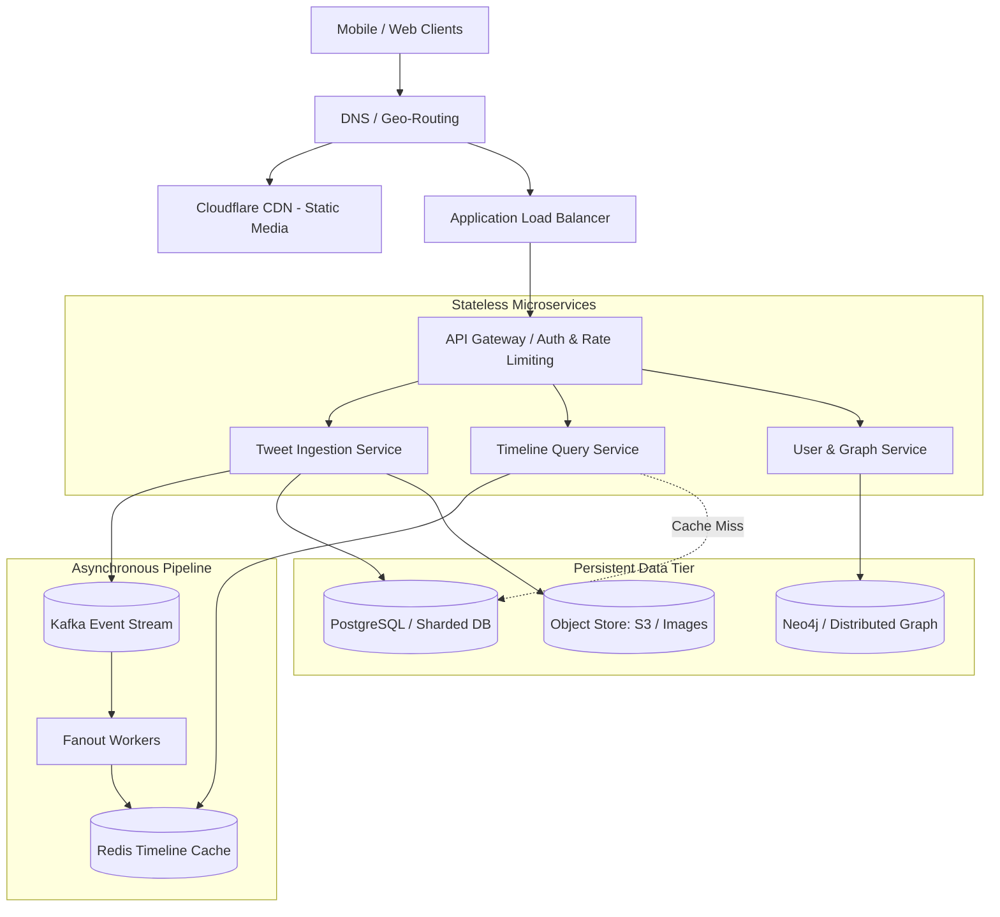

## TL;DR

The system design interview is not a test of memory—it is a **simulation of senior engineering collaboration**:
1. **0:00 – 0:05 | Step 1: Scope & Clarifying Questions**: Define 3–4 core functional requirements, 3 key non-functional requirements (Availability vs Consistency, p99 Latency, Scale), and explicitly eliminate out-of-scope features.
2. **0:05 – 0:10 | Step 2: Capacity Estimation & APIs**: Fast back-of-the-envelope math (QPS, 5-year storage, bandwidth). Define REST/gRPC endpoints with request/response payloads and idempotency keys.
3. **0:10 – 0:25 | Step 3: High-Level Architecture**: Draw end-to-end data flow (Client $\to$ DNS $\to$ LB $\to$ API Gateway $\to$ Services $\to$ DB / Cache / Message Queue). Walk through the primary write path and read path.
4. **0:25 – 0:40 | Step 4: Component Deep-Dive**: Dive into the hardest 2–3 problems (partitioning strategy, cache invalidation, consensus, distributed locking, hot keys).
5. **0:40 – 0:45 | Step 5: Failure Modes & Wrap-up**: SPOFs, blast radius containment, circuit breakers, rate limiting, telemetry/metrics, and cost optimization.

---

## Why It Matters

Most candidates fail system design interviews not because they lack technical knowledge, but because of **structural failure**:
- Jumping directly to drawing architecture boxes before clarifying requirements (solving the wrong problem).
- Getting bogged down in trivial details (discussing CSS or database column types for 20 minutes).
- Silence and passivity: Waiting for the interviewer to tell them what to do next.
- Inability to justify technology choices with concrete trade-offs ("I chose Cassandra because it's scalable" instead of "I chose Cassandra because our write QPS is 50,000, writes are append-only with no relational joins, and tunable consistency satisfies our SLA").

A repeatable framework eliminates interview anxiety and keeps the discussion structured and authoritative.

---

## Core Concepts & Mental Models

### The 45-Minute Interview Clock

```mermaid
gantt
    title 45-Minute System Design Interview Allocation
    dateFormat mm
    axisFormat %M min

    section Scoping
    Step 1: Clarify Scope & Requirements :active, 00, 05m
    Step 2: Capacity Math & API Design    :05, 10m

    section Architecture
    Step 3: High-Level End-to-End Diagram :10, 25m

    section Mastery
    Step 4: Architectural Deep-Dive       :crit, 25, 40m

    section Resilience
    Step 5: Failure Modes, SRE & Wrap-up  :40, 45m
```



---

## The 5-Step Repeatable Blueprint

### Step 1: Clarify Scope & Requirements (5 Minutes)

#### 1. Functional Requirements (Select 3 to 4 core use cases)
Never attempt to design the entire product in 45 minutes.
- Example for Twitter:
  - 1. User can post a tweet (text + optional image).
  - 2. User can follow other users.
  - 3. User can view a home timeline of tweets from followed users.
  - 4. User can search tweets by keyword.
- Explicitly state what is **Out of Scope**: Direct messages, monetization, trending algorithms.

#### 2. Non-Functional Requirements (The "Ilities")
- **High Availability vs Strong Consistency**: Can timelines be eventually consistent? (Yes, CAP theorem favours AP). Can payment transactions be eventually consistent? (No, requires strong consistency/ACID).
- **Latency**: What is the target p99 latency? (e.g., Timeline read $< 200\text{ ms}$, tweet post $< 500\text{ ms}$).
- **Scale**: Target Daily Active Users (e.g., 200M DAU, global distribution).
- **Durability**: Zero data loss for published tweets.

---

### Step 2: Capacity Math & API Design (5 Minutes)

#### 1. Quick Estimation Check
- Read-to-write ratio ($100:1$ for feed systems, $1:1$ for chat systems).
- Peak QPS calculation ($100\text{M writes/day} \approx 1,200\text{ avg QPS} \implies 3,000\text{ peak QPS}$).
- Storage sizing (5-year volume in TB/PB).

#### 2. Contract & API Design
Define clean, idiomatic endpoints:

```http
POST /v1/tweets
Authorization: Bearer <jwt_token>
Idempotency-Key: <uuid>
Content-Type: application/json

{
  "content": "Hello distributed systems!",
  "media_ids": ["img_987234"]
}

Response: 201 Created
{
  "tweet_id": "tw_893475892345",
  "created_at": "2026-10-25T18:00:00Z"
}
```

```http
GET /v1/timelines/home?limit=20&cursor=tw_893475892345
Authorization: Bearer <jwt_token>

Response: 200 OK
{
  "tweets": [...],
  "next_cursor": "tw_893475892300"
}
```

*Highlight: Mention pagination strategy (Cursor-based vs Offset-based) and idempotency keys.*

---

### Step 3: High-Level Architecture (15 Minutes)

Draw the end-to-end request flow cleanly:



**Walk through the user journey step-by-step**:
1. User uploads a tweet $\implies$ Gateway validates JWT and checks rate limit $\implies$ Tweet Service writes metadata to database and emits an event to Kafka.
2. Background Fanout Workers consume event and push tweet ID into all followers' Redis timeline lists (Fanout-on-write).
3. User opens app $\implies$ Timeline Service fetches pre-computed list of tweet IDs from Redis in $< 5\text{ ms}$, hydrates tweet text, and returns.

---

### Step 4: Component Deep-Dive (15 Minutes)

This is where candidates earn a **Senior (L5)** vs **Staff (L6)** evaluation. Pick the 2 most challenging bottlenecks:
1. **The Celebrity Problem (Hot Partitioning)**:
   - When a user with 100M followers posts, fanout-on-write attempts to insert 100M records into 100M Redis lists, creating severe backpressure.
   - *Solution*: Hybrid Fanout Architecture. Regular users use fanout-on-write. Celebrities (>50k followers) use fanout-on-read: their tweets are merged dynamically when followers query their timeline.
2. **Data Model & Partitioning Strategy**:
   - Choose partition key (e.g., `user_id` vs `tweet_id`).
   - If sharded by `user_id`: Fetching user tweets is efficient (single shard), but reading timeline requires multi-shard scatter-gather.

---

### Step 5: Failure Modes, SRE & Wrap-up (5 Minutes)

Proactively address system resilience:
- **Single Points of Failure (SPOF)**: Every component has $N+1$ redundancy across multiple Availability Zones.
- **Circuit Breakers & Graceful Degradation**: If Redis crashes, fall back to degraded algorithmic feeds or database read replicas; do not take down the entire service.
- **Observability**: Distributed tracing (OpenTelemetry), RED metrics (Rate, Errors, Duration), and SLO monitoring.

---

## Production Architectures & Implementations

### Interviewer Rubric: L5 (Senior) vs L6 (Staff)

| Evaluation Dimension | L5 (Senior Engineer) | L6 (Staff Engineer) |
| :--- | :--- | :--- |
| **Interview Leadership** | Answers interviewer questions when prompted; needs occasional hints | Takes ownership of the whiteboard; guides conversation; states assumptions clearly |
| **Trade-off Analysis** | Understands technologies (e.g., SQL vs NoSQL) | Quantifies trade-offs against SLAs, operational costs, network latency, and team complexity |
| **Failure Handling** | Mentions adding retries or backups | Designs circuit breakers, bulkhead isolation, idempotency keys, and discusses split-brain mitigation |
| **Capacity Planning** | Computes numbers correctly | Directly translates capacity numbers into concrete hardware/cloud instance counts and architectural decisions |

---

## Failure Modes & Common Interview Mistakes

1. **The Silent Candidate**: Drawing architecture silently for 5 minutes. *Rule: Think out loud constantly.*
2. **Premature Optimization**: Spending 10 minutes discussing Raft consensus or Bloom filters before the basic HTTP flow is even established.
3. **Defensiveness**: Arguing with the interviewer when they introduce a constraint or failure scenario. *Rule: Treat feedback as new system requirements.*
4. **Ignoring Non-Functional Constraints**: Proposing strong two-phase commit transactions for a social media like button.

---

## Interview Questions & Model Answers

### Question 1: How should you respond when an interviewer says "Design YouTube"? [Basic]

**Senior / Staff Answer**:
Do not immediately start drawing video streaming microservices. YouTube encompasses video upload, transcode, video streaming, search, recommendations, comments, and monetization.
1. State: *"YouTube is a massive ecosystem. To make our 45 minutes as productive as possible, I'd like to scope this down to the core features: 1) Video upload and transcoding, and 2) High-availability low-latency video streaming to global users. We can treat search and comments as out-of-scope for now. Does that align with what you'd like to evaluate?"*
2. This establishes domain leadership, executive communication, and prevents wandering into sprawling, un-gradable territory.

**Interviewer Evaluation Rubric**:
- *Pass*: Asks what specific features to focus on.
- *Distinction*: Proactively proposes the exact 2 core use cases, suggests out-of-scope boundaries, and seeks explicit alignment.

---

### Question 2: Why is offset-based pagination (`OFFSET 10000 LIMIT 20`) dangerous in high-scale systems, and what should you propose instead? [Intermediate]

**Senior / Staff Answer**:
- **Performance Collapse ($O(N)$ Disk Scan)**: In relational databases, `OFFSET 1000000 LIMIT 20` forces the database engine to scan and discard 1,000,000 index entries or rows before returning the 20 requested records. Latency increases linearly with page depth.
- **Data Inconsistency (Page Drift)**: If new records are inserted while a user scrolls from page 1 to page 2, rows shift positions. The user sees duplicate items or misses items entirely.
- **Superior Pattern: Keyset / Cursor-Based Pagination**:
  - Pass a pointer to the last retrieved record: `WHERE (created_at, id) < (:last_timestamp, :last_id) ORDER BY created_at DESC, id DESC LIMIT 20`.
  - The database performs an $O(\log N)$ B-tree index seek directly to the target record, guaranteeing constant $O(1)$ lookup time regardless of scroll depth, with zero item duplication.

**Interviewer Evaluation Rubric**:
- *Pass*: Explains that offset becomes slow for deep pages.
- *Distinction*: Explains the B-tree row-scanning mechanics, page drift anomaly, and writes the keyset SQL/API contract.

---

### Question 3: How do you address the "Celebrity Problem" (Hot User Partition) in a fanout architecture? [Intermediate]

**Senior / Staff Answer**:
The Celebrity Problem occurs when a user with tens of millions of followers (e.g., Elon Musk or Taylor Swift) posts:
- In a pure **Fanout-on-Write (Push)** model: 1 post triggers 100 million background write operations across 100 million separate Redis timeline lists. This creates message queue backlog and delays timeline updates for all other users.
- In a pure **Fanout-on-Read (Pull)** model: Timeline reads must query and merge recent tweets from all followed accounts at query time, making reads slow and CPU-intensive.
- **The Staff Solution: Hybrid Fanout Architecture**:
  1. Classify users based on follower count (threshold e.g. 25,000 followers).
  2. For standard users: Use fanout-on-write (push to followers' Redis timelines).
  3. For celebrity users: Bypass fanout-on-write. Write the post only to the celebrity's individual timeline.
  4. When an active follower opens their app: Retrieve their pre-computed Redis timeline, fetch the recent tweets of the few celebrities they follow from cache, and merge-sort the results in memory before returning.

**Interviewer Evaluation Rubric**:
- *Pass*: Mentions that pushing to millions of followers creates high load.
- *Distinction*: Proposes the hybrid push/pull threshold model and details how timeline merge-sorting works.

---

### Question 4: How do you gracefully handle network partitions in a globally distributed service according to PACELC? [Advanced]

**Senior / Staff Answer**:
The PACELC theorem states that: If there is a **Partition (P)**, a system must trade off **Availability (A)** vs **Consistency (C)**; **Else (E)**, even during normal operation, the system must trade off **Latency (L)** vs **Consistency (C)**.
- **Designing for Partition (P)**:
  - If financial/ledger data: Choose **PC/EC** (e.g., Spanner, CockroachDB). Refuse writes in the minority partition to prevent split-brain and reconciliation nightmares.
  - If social/shopping cart data: Choose **PA/EL** (e.g., DynamoDB, Cassandra). Accept writes in all partitions using conflict-free replicated data types (CRDTs) or Last-Write-Wins (LWW) and reconcile asynchronously after partition heals.
- **Designing for Normalcy (Else)**:
  - Even without network cuts, demanding strong linearizable consistency across transatlantic datacenters costs 150ms round-trip latency per write. Adopting read-committed or eventual consistency with local replicas guarantees single-digit millisecond latency.

**Interviewer Evaluation Rubric**:
- *Pass*: References CAP theorem (choosing Availability vs Consistency).
- *Distinction*: Cites PACELC theorem, addresses latency vs consistency trade-offs in the absence of partitions, and pairs data types (financial vs social) with appropriate consensus models.

---

### Question 5: How do you prevent cascade failures across microservices when a downstream dependency experiences degraded latency? [Advanced]

**Senior / Staff Answer**:
When downstream Service B slows down from 20ms to 5,000ms:
1. **Thread / Connection Pool Starvation**: Upstream Service A keeps HTTP threads open waiting for Service B. Soon, Service A exhausts its connection pool and cannot serve unrelated requests, cascading the outage upstream to the API gateway.
2. **Mitigation Strategy (Resilience Engineering)**:
   - **Strict Timeouts & Deadlines**: Never use infinite timeouts. Set aggressive p99 timeout limits (e.g., 300ms) with context deadline propagation.
   - **Circuit Breakers (Netflix Hystrix / Resilience4j pattern)**: If error/timeout rate exceeds 50% over a 10-second window, trip the circuit to `OPEN`. All incoming calls fail immediately or return a cached fallback without touching Service B. Periodically transition to `HALF-OPEN` to test recovery.
   - **Bulkheading**: Isolate thread pools or connection pools per downstream service so an outage in Service B cannot starve resources allocated to Service C.
   - **Exponential Backoff with Full Jitter**: Prevent the "thundering herd" problem when Service B recovers:
     $$T_{\text{sleep}} = \text{random}(0, \min(T_{\text{max}}, T_{\text{base}} \times 2^{\text{attempt}}))$$

**Interviewer Evaluation Rubric**:
- *Pass*: Recommends timeouts and retries.
- *Distinction*: Identifies thread pool starvation as the root cause of cascading failure, details circuit breaker state machines (Closed, Open, Half-Open), bulkheading, and exponential backoff with jitter.
