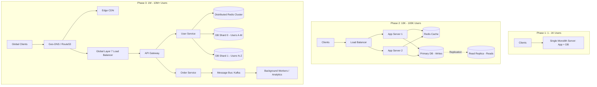

## TL;DR

Scaling an application is an evolutionary process driven by identifying and eliminating specific hardware and architectural bottlenecks:
1. **Single Server (0 to 1,000 Users)**: Everything runs on one box (Web server, App logic, Database). Dead simple, fast iteration, single point of failure (SPOF).
2. **Dedicated DB Tier (1,000 to 10,000 Users)**: Decouple database from web application into separate compute instances to eliminate CPU/Memory contention.
3. **Read Replicas & In-Memory Cache (10,000 to 100,000 Users)**: Primary-replica DB setup for 80:20 read-heavy workloads. Place Redis/Memcached in front of the database for hot reads.
4. **Stateless Tier & Load Balancer (100,000 to 1,000,000 Users)**: Move user sessions into external stores (Redis). Run multiple stateless application instances behind an Nginx/ALB load balancer.
5. **Static CDN & Multi-AZ (1M to 5M Users)**: Offload images, video, and static assets to Cloudflare/CloudFront edge nodes. Deploy database and compute across multiple availability zones.
6. **Data Sharding & Microservices / Messaging (5M to 10M+ Users)**: Shard relational databases horizontally by tenant/user ID. Decouple synchronous API calls using asynchronous message queues (Kafka, RabbitMQ, SQS).

---

## Why It Matters

Every system design interview begins with either an existing monolithic service or a greenfield problem where the candidate must propose an initial architecture and incrementally evolve it to handle millions of active users. 

Jumping directly to distributed microservices, Apache Kafka, and NoSQL distributed consensus for an early-stage app is an immediate red flag indicating **over-engineering**. Conversely, failing to understand how bottlenecks manifest (connection exhaustion, disk IOPS saturation, cache stampedes, or replication lag) demonstrates a lack of production experience.

Mastering this evolution provides the mental scaffolding to justify every architectural addition with concrete mathematical and operational reasons.

---

## Core Concepts & Mental Models

### The Evolutionary Spectrum



---

## The 6 Scaling Phases

### Phase 1: The All-in-One Monolith (0 to 1,000 Users)

When starting a project, simplicity and velocity dominate.
- **Topology**: A single virtual machine (e.g., AWS EC2 `t4g.small` or a VPS) hosting an HTTP server (Nginx), an application runtime (Node.js, Go, or Python/Django), and a relational database (PostgreSQL/MySQL).
- **Bottlenecks**:
  - Memory contention: The database engine buffer pool and the application runtime compete for physical RAM.
  - Zero redundancy: If the VM restarts or disk fills up, the service is completely down.

### Phase 2: Decoupling Compute & Storage (1,000 to 10,000 Users)

The first scaling step separates state from execution.
- **Topology**: The application runs on VM 1; PostgreSQL runs on a dedicated database instance (VM 2 or managed AWS RDS).
- **Why this works**:
  - App servers are CPU/network-bound; database servers are memory and disk I/O-bound.
  - Compute tiers can be upgraded independently (e.g., more CPU for web parsing, high IOPS SSDs for database WAL).

### Phase 3: Caching & Read Replication (10,000 to 100,000 Users)

Most web applications follow an asymmetric read/write ratio (e.g., 90% reads, 10% writes for social feeds or e-commerce).
- **In-Memory Caching (Redis/Memcached)**:
  - Intercept read queries before they hit the database.
  - Cache hot query results, session states, and pre-computed aggregations.
  - Latency drops from 15ms (disk lookup + joins) to < 1ms (RAM lookup).
- **Read Replicas (Primary-Replica Topology)**:
  - Write queries (INSERT, UPDATE, DELETE) route strictly to the Primary DB.
  - Read queries (SELECT) distribute across one or more Read Replicas via asynchronous replication.
- **Failure Mode & Trade-off**:
  - **Replication Lag**: A user writes a comment and immediately refreshes their page. If the read hits a replica that is 200ms behind, the new comment is missing.
  - *Mitigation*: Read-your-own-writes pattern (route user's reads to the Primary DB for 5 seconds after a write).

### Phase 4: Horizontal Compute Scaling & Stateless App Tier (100,000 to 1,000,000 Users)

When vertical scaling of the application server hits diminishing returns (cost vs throughput), scale horizontally.
- **Load Balancer (Layer 7)**:
  - AWS ALB or Nginx distributes incoming traffic across multiple identical application instances using Round-Robin, Least Connections, or IP Hash.
- **Stateless Architecture**:
  - Never store session state, uploaded files, or websocket state in server local memory.
  - Store JWT/session tokens in Redis or client-side signed cookies.
  - Store uploaded media directly in Object Storage (AWS S3, Google Cloud Storage).
  - Any server can crash or be terminated by autoscaling without dropping user sessions.

### Phase 5: Edge Acceleration (CDN) & Multi-Region (1M to 5M Users)

Network latency is physically constrained by the speed of light in fiber (~5ms per 1,000 km). Users on another continent experience 150–300ms round trips.
- **Content Delivery Network (CDN)**:
  - Deploy Cloudflare, Akamai, or AWS CloudFront to cache static files (CSS, JS, images, videos) at edge points of presence (PoPs) within 10ms of end users.
  - Dynamic content caching: Cache API responses with `Cache-Control: s-maxage=60, stale-while-revalidate`.
- **Database Connection Pooling**:
  - As app instances scale from 10 to 100, opening 50 DB connections per instance overwhelms PostgreSQL (max connections ~500–1,000).
  - Deploy **PgBouncer** or AWS RDS Proxy to multiplex thousands of client connections onto a small pool of database backend processes.

### Phase 6: Sharding, Asynchronous Decoupling & Microservices (5M to 10M+ Users)

At this tier, single-primary relational databases reach write saturation (IOPS limits on SSDs, lock contention on hot tables).
- **Database Sharding (Horizontal Partitioning)**:
  - Split data across multiple independent primary database instances using a shard key (e.g., `user_id % num_shards` or consistent hashing).
  - *Trade-off*: Cross-shard joins and distributed transactions become prohibitively expensive. Application logic must handle data aggregation.
- **Asynchronous Messaging**:
  - Decouple slow operations (email delivery, video encoding, payment settlement, audit logging) from the synchronous HTTP request path using Kafka, RabbitMQ, or AWS SQS.
  - Web servers push events to the message broker and return `202 Accepted` immediately. Background worker pools consume and process jobs at their own pace.

---

## Production Architectures & Implementations

### Tiered Scaling Matrix

| Metric / Dimension | Phase 1 (1K) | Phase 3 (100K) | Phase 6 (10M+) |
| :--- | :--- | :--- | :--- |
| **Compute Topology** | 1 Monolith Server | 3–5 App Instances + LB | Hundreds of containers (K8s/ECS) |
| **Database Model** | Single SQLite / Postgres | Primary + 2 Read Replicas | Multi-shard DB + NoSQL (Cassandra/Dynamo) |
| **Caching Layer** | Local in-process memory | Redis Cluster (Cache-Aside) | Multi-tier: Edge CDN + Redis + Local L1 |
| **File Storage** | Local filesystem `/var/www` | Object Store (AWS S3) | S3 + CloudFront CDN + Signed URLs |
| **Asynchronous Ops** | In-process cron / threads | Redis Celery / BullMQ | Apache Kafka / EventBridge |
| **Deployment Model** | Manual git pull / PM2 | Docker + GitHub Actions CI/CD | GitOps (ArgoCD) + Blue-Green / Canary |

---

## Failure Modes & Mitigation Strategies

```
+---------------------------+-----------------------------------+------------------------------------------+
| Failure Mode              | Root Cause                        | Production Mitigation                    |
+---------------------------+-----------------------------------+------------------------------------------+
| Database Connection Storm | App instances autoscale up; each  | Deploy connection pooler (PgBouncer) or  |
|                           | spawns new DB connections         | cloud managed proxy (AWS RDS Proxy)      |
+---------------------------+-----------------------------------+------------------------------------------+
| Cache Stampede (Dogpile)  | Hot key expires under 10k QPS;    | Mutual exclusion lock (single-flight) or |
|                           | all requests hit DB simultaneously| probabilistic early expiration (XFetch)  |
+---------------------------+-----------------------------------+------------------------------------------+
| Replication Lag Reads     | Slave replica lagging behind      | Sticky reads to primary after user write |
|                           | master under heavy write load     | or monotonic read consistency tokens     |
+---------------------------+-----------------------------------+------------------------------------------+
| Split-Brain Sharding      | Network partition between shard   | Consensus algorithms (Raft/Paxos) or     |
|                           | replicas causes dual primaries    | strict fencing tokens                    |
+---------------------------+-----------------------------------+------------------------------------------+
```

---

## Real-World Case Studies

### 1. Instagram: From Single Box to 10 Million Users in 18 Months
- **Phase 1**: Mike Krieger and Kevin Systrom launched Instagram on a single Amazon EC2 `m1.large` instance running Ubuntu, Django, and PostgreSQL.
- **Phase 2**: Within months, CPU and memory bottlenecked. They split Django onto separate compute nodes and moved PostgreSQL to a dedicated `m2.4xlarge` instance.
- **Phase 3**: Read load skyrocketed. They deployed Redis to cache the social graph and user feeds in memory, and added read replicas to PostgreSQL.
- **Phase 4**: Write throughput hit PostgreSQL limits on photo uploads and likes. They avoided complex NoSQL migrations by horizontally sharding PostgreSQL into thousands of logical shards across multiple physical RDS instances using a custom 64-bit ID generator combining timestamp, shard ID, and auto-increment sequence.

---

## Interview Questions & Model Answers

### Question 1: How do you identify whether your database is write-bound versus read-bound? [Basic]

**Senior / Staff Answer**:
Examine telemetry metrics:
1. **Read-Bound Indicators**: High buffer pool cache-hit misses, high read IOPS, high CPU utilization during table scans/joins, and elevated p95/p99 query latencies on `SELECT` statements.
2. **Write-Bound Indicators**: High disk write IOPS, saturation of the Write-Ahead Log (WAL) flushing rate, row-level lock wait times, lock contention spikes, and replication lag growing unbounded on secondary replicas.
3. **Remediation**:
   - If read-bound: Add an in-memory cache (Redis), add read replicas, or add covering indexes to eliminate full table scans.
   - If write-bound: Adding read replicas does NOT help (it actually increases primary replication overhead). You must optimize write batching, tune WAL disk throughput (provisioned IOPS), shard the database, or offload append-only data to an event log or NoSQL store.

**Interviewer Evaluation Rubric**:
- *Pass*: Explains that read-bound means too many SELECTs and write-bound means disk flush/lock contention.
- *Distinction*: Points out that read replicas worsen write-bound systems due to primary replication overhead, and highlights WAL/IOPS metrics.

---

### Question 2: Why is sticky-session (session affinity) considered an anti-pattern for scaling web applications? [Intermediate]

**Senior / Staff Answer**:
Sticky sessions force the Layer 7 load balancer to route all subsequent requests from a specific client to the exact same server instance where their session was first created.
1. **Uneven Load Distribution**: If a power user or automated crawler connects, that single server instance gets overloaded while adjacent nodes remain idle.
2. **Autoscaling Inefficiency**: Scaling down or terminating an instance abruptly disconnects active users or drops their cart/session state.
3. **Failover Complexity**: If an instance crashes, all sessions stored in its local memory are lost permanently.
4. **Best Practice**: Treat all application servers as stateless cattle, not pets. Store session state in a distributed cache (Redis) or use self-contained cryptographically signed tokens (stateless JWTs).

**Interviewer Evaluation Rubric**:
- *Pass*: Mentions session loss when a server restarts.
- *Distinction*: Explains traffic hot-spotting, autoscaling impedance, and provides the production pattern (Redis session store / JWT).

---

### Question 3: How does introducing an in-memory cache like Redis introduce the dual-write problem, and how do you resolve it? [Intermediate]

**Senior / Staff Answer**:
When an application uses both a database (source of truth) and a cache (Redis), modifying data requires updating two distinct storage systems without a shared distributed transaction.
- **Race Condition 1 (Update DB, Update Cache)**: Thread A updates DB to value 1. Thread B updates DB to value 2. Due to network latency, Thread B updates Cache to value 2 first, then Thread A overwrites Cache with stale value 1. The cache is now permanently out of sync.
- **Race Condition 2 (Delete Cache, Update DB)**: Thread A deletes cache key. Thread B reads cache (miss), reads DB (old value). Thread A writes DB (new value). Thread B writes old value into cache.
- **Standard Resolution (Cache-Aside with Invalidation)**:
  1. Always **Update Database first, then Delete (invalidate) the cache key**.
  2. Set an appropriate **TTL (Time-To-Live)** on all cache keys as a safety net.
  3. For absolute consistency, use **Change Data Capture (CDC)** with Debezium/Kafka to stream database binlog events directly to cache invalidator workers.

**Interviewer Evaluation Rubric**:
- *Pass*: Recommends updating DB first then invalidating cache.
- *Distinction*: Explains why updating cache directly creates race conditions and mentions binlog CDC for reliable asynchronous invalidation.

---

### Question 4: Under what conditions should you choose Database Sharding over Vertical Scaling or Read Replicas? [Advanced]

**Senior / Staff Answer**:
Sharding introduces massive operational complexity (cross-shard joins fail, schema migrations require orchestration, re-sharding is painful). It should only be adopted when:
1. **Storage Capacity Limits**: The dataset exceeds the maximum storage capacity of the largest cloud instance (e.g., > 64 TB on AWS RDS).
2. **Write Throughput Saturation**: The write IOPS or CPU required for transaction commit/locking exceeds the limits of the largest bare-metal or cloud hardware (e.g., > 100,000 write QPS).
3. **Network Bandwidth Limits**: Inbound and outbound network bandwidth saturates the NIC of a single instance.
4. If the bottleneck is purely read queries, read replicas or caching should be exhausted first. If the bottleneck is table size causing slow queries, table partitioning (declarative range/list partitioning on a single primary) and indexing should precede multi-instance sharding.

**Interviewer Evaluation Rubric**:
- *Pass*: Mentions dataset size and high write throughput.
- *Distinction*: Clearly states that sharding is a last resort after caching, read replicas, and single-instance partitioning, and highlights the operational penalty of cross-shard operations.

---

### Question 5: How does database connection exhaustion occur, and why doesn't increasing max_connections indefinitely solve it? [Advanced]

**Senior / Staff Answer**:
In PostgreSQL and MySQL, each client connection consumes server resources:
- In PostgreSQL, each connection is an OS process allocating private memory (e.g., `work_mem`, stack, connection buffers, ~5–10MB per connection).
- 5,000 open connections consume 25–50GB of RAM just idling.
- **Context Switching Bottleneck**: When thousands of processes compete for 32 or 64 CPU cores, the OS spends more CPU cycles performing kernel context switching and lock contention than executing queries. Throughput collapses while latency skyrockets (thrashing).
- **Solution**:
  - Deploy an external connection pooler like **PgBouncer** in transaction pooling mode.
  - It multiplexes 10,000 application client connections over a tight pool of only 50–100 active database backend connections, matching the CPU core count and maximizing cache locality and query throughput.

**Interviewer Evaluation Rubric**:
- *Pass*: Identifies that each connection consumes RAM and server CPU.
- *Distinction*: Articulates the process-per-connection architecture of PostgreSQL, context switching thrashing, and specifies transaction pooling via PgBouncer.
