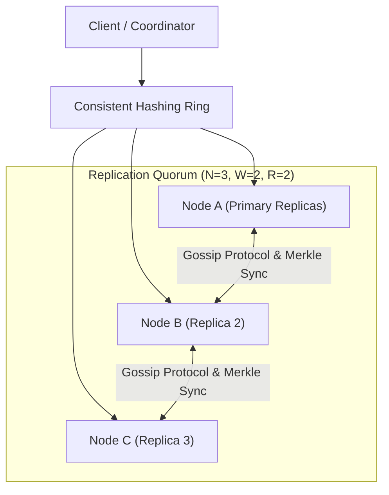

## 1. Problem Statement & Historical Context

In the mid-2000s, Amazon's e-commerce platform operated on monolithic relational database clusters (primarily Oracle). During peak shopping holidays (Black Friday, Cyber Monday), these databases encountered catastrophic scale ceilings:
- **Lock Contention**: Strict ACID 2-Phase Locking (2PL) crippled write throughput.
- **Availability Failures**: Under network partitions or server crashes, database clusters chose consistency over availability, rejecting checkout transactions and losing millions in revenue.
- **The Core Business Mandate**: A customer must **never** be prevented from adding an item to their shopping cart. Writes must **always succeed** even during datacenter network cuts.

This led Giuseppe DeCandia and Werner Vogels to architect **Dynamo: Amazon's Highly Available Key-Value Store** (published at SOSP 2007).

---

## 2. Key Ideas & Core Techniques

Dynamo synthesized five foundational distributed systems techniques into a master blueprint:

| Problem Solved | Technique Used | Core Mechanism |
| :--- | :--- | :--- |
| **Partitioning & Scale** | **Consistent Hashing** | Virtual nodes on a circular ring; rebalancing touches only $1/N$ keys. |
| **High Write Availability** | **Sloppy Quorums & Hinted Handoff** | Writes succeed on healthy neighboring nodes even if primary replicas are down. |
| **Data Versioning** | **Vector Clocks** | Captures causal relationships between concurrent modifications; conflicts resolved on read. |
| **Background Anti-Entropy** | **Merkle Trees** | Hierarchical hash trees compare data differences between replicas in $O(\log N)$ network exchanges. |
| **Failure Detection** | **Gossip Protocol** | Decentralized, peer-to-peer heartbeat state dissemination with zero single point of failure. |

---

## 3. Architecture Deep Dive

### 1. Consistent Hashing with Virtual Nodes
Dynamo maps keys and server nodes to a 128-bit circular ring using MD5. To avoid non-uniform load distribution, each physical machine is assigned multiple **virtual nodes (tokens)**. If a physical node fails, its load is evenly shared across all surviving peers.

### 2. Sloppy Quorums & Hinted Handoff
Traditional quorums reject writes if designated replica nodes are unreachable. Dynamo uses **Sloppy Quorums**: if Node A is down, Node D temporarily accepts the write and tags it with a "hint" header. When Node A recovers, Node D delivers the hinted handoff to Node A.

### 3. Vector Clocks & Read Reconciliation
Because writes never wait for locks, concurrent writes create diverging histories. Dynamo tracks causally related updates using **Vector Clocks** (lists of `(node, counter)` pairs).
- If one clock subsumes another, the newer version is taken.
- If clocks diverge, the conflict is returned to the client application on read to reconcile (e.g., merging two shopping carts).

---

## 4. Trade-offs & Limitations

1. **Read Reconciliation Burden on the Client**:
   Shifting conflict resolution to the application layer forces client code (e.g. cart services) to handle multiple conflicting versions (siblings), adding substantial software complexity.
2. **Re-appearing Deleted Items (Resurrected Objects)**:
   In distributed conflict resolution, if a delete operation occurs and a stale replica syncs without tombstones, deleted items can reappear in a user's cart.
3. **No Secondary Indexes**:
   Dynamo is purely a key-value store. Complex queries, aggregations, and multi-key atomic transactions are unsupported.

---

## 5. Industry Influence & Legacy

The 2007 Dynamo paper ignited the entire modern **NoSQL revolution**:
- **Apache Cassandra**: Directly adopted Dynamo's ring topology, gossip protocol, and tunable quorums, merging it with Google Bigtable's LSM storage engine.
- **Riak**: An open-source Erlang implementation directly modeled on Dynamo.
- **Amazon DynamoDB**: AWS's managed commercial database, evolved from Dynamo principles while replacing vector clocks with internal Paxos consensus for predictable consistency.

---

## 6. Interview Relevance

- **Core Interview Topic**: Used frequently when designing distributed key-value stores (e.g. *"Design a distributed KV store with 99.999% write availability"*).
- **Key Concepts to Mention**:
  - Always explain **Quorums ($R + W > N$)** and why Sloppy Quorums prioritize availability over consistency (AP in CAP).
  - Describe how **Merkle Trees** synchronize out-of-sync replicas without reading the entire dataset over the network.
  - Explain the difference between **Dynamo (the 2007 paper)** and **DynamoDB (the managed AWS product)**.
