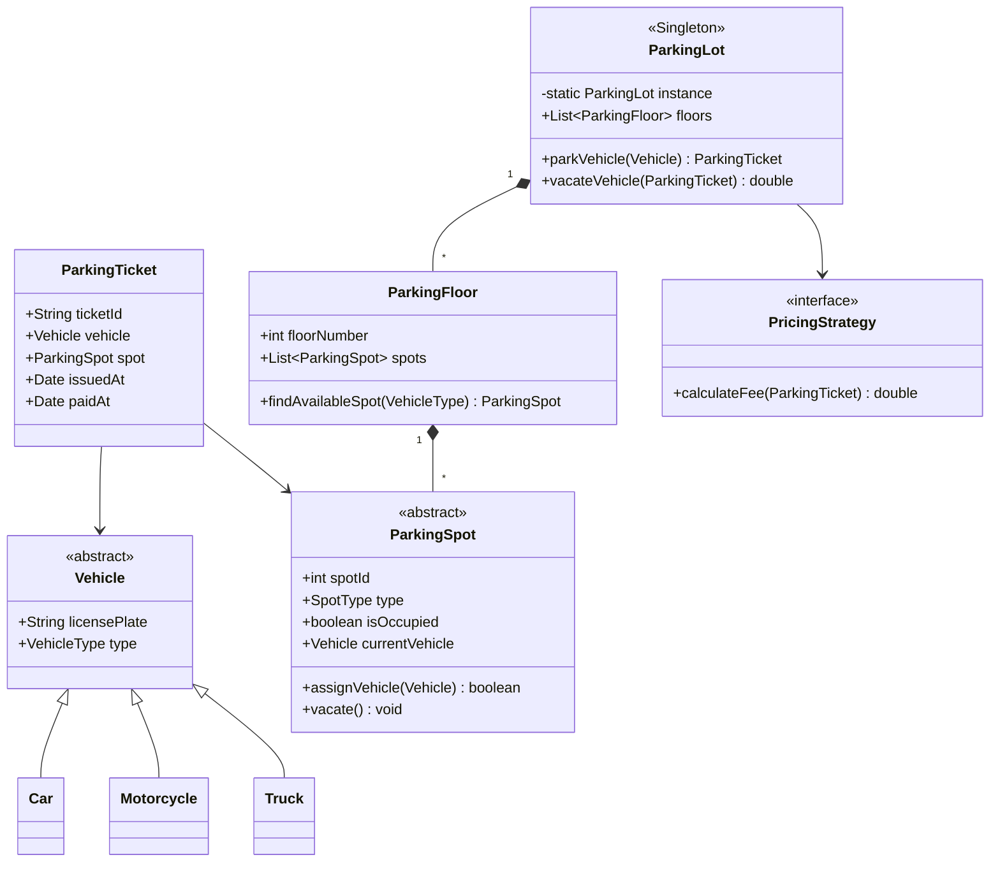
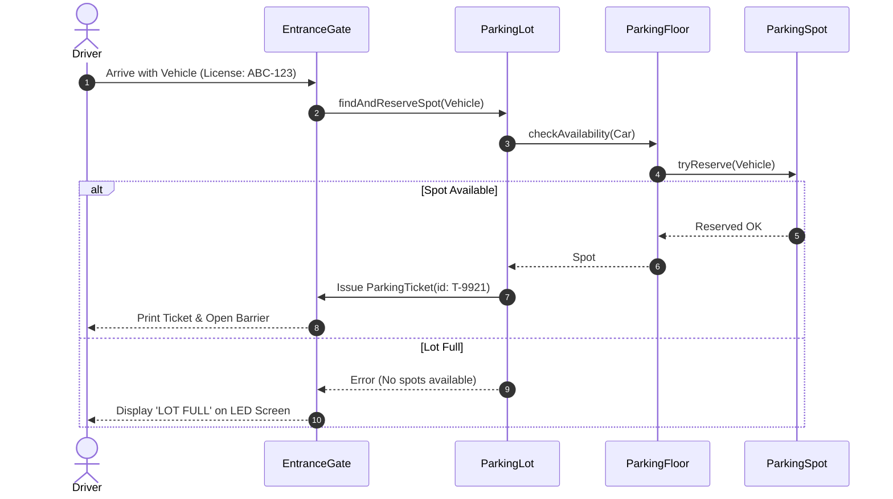

## 1. Requirements & Assumptions

Design an automated, multi-floor parking lot management system capable of tracking vehicle ingress, parking spot assignment, fee calculation, and egress.

### Assumptions:
1. **Multi-Floor & Multi-Spot**: The parking lot contains multiple levels. Each level has designated spots for different vehicle types:
   - Motorcycle (Small spot)
   - Car / Compact SUV (Medium spot)
   - Large Truck / Bus (Large spot)
   - Electric Vehicle (EV spot with charging station)
2. **Multiple Entry & Exit Gates**: Multiple gates operate concurrently.
3. **Automated Ticketing**: An entry gate issues a timestamped ticket upon vehicle arrival.
4. **Dynamic Fee Calculation**: Pricing differs by vehicle type and parking duration (e.g. flat rate for first hour, hourly afterwards).

---

## 2. Entities & Core Domain Relationships

- **Vehicle**: Abstract base class (`Motorcycle`, `Car`, `Truck`, `ElectricVehicle`).
- **ParkingSpot**: Abstract base class (`CompactSpot`, `HandicappedSpot`, `LargeSpot`, `EVSpot`).
- **ParkingFloor**: Manages a collection of spots on a specific level.
- **ParkingLot**: Singleton orchestrator managing floors, gates, and global capacity.
- **ParkingTicket**: Represents an active parking session (entry time, assigned spot, vehicle license plate).
- **PricingStrategy**: Strategy interface (`HourlyPricingStrategy`, `FlatRateStrategy`).
- **Gate**: Base class for `EntranceGate` and `ExitGate`.

---

## 3. Class Diagram (Mermaid)



---

## 4. Key Sequence & State Diagram

### Vehicle Parking Sequence


---

## 5. Production-Ready Code (TypeScript)

```typescript
// 1. Vehicle Taxonomy
export enum VehicleType {
  MOTORCYCLE,
  CAR,
  TRUCK,
}

export abstract class Vehicle {
  constructor(public readonly licensePlate: string, public readonly type: VehicleType) {}
}

export class Car extends Vehicle {
  constructor(licensePlate: string) {
    super(licensePlate, VehicleType.CAR);
  }
}

export class Motorcycle extends Vehicle {
  constructor(licensePlate: string) {
    super(licensePlate, VehicleType.MOTORCYCLE);
  }
}

// 2. Parking Spot Hierarchy
export enum SpotType {
  SMALL,
  MEDIUM,
  LARGE,
}

export abstract class ParkingSpot {
  private occupied: boolean = false;
  private currentVehicle: Vehicle | null = null;

  constructor(public readonly id: string, public readonly spotType: SpotType) {}

  public isAvailable(): boolean {
    return !this.occupied;
  }

  public abstract canFitVehicle(vehicle: Vehicle): boolean;

  public assignVehicle(vehicle: Vehicle): boolean {
    if (!this.isAvailable() || !this.canFitVehicle(vehicle)) {
      return false;
    }
    this.currentVehicle = vehicle;
    this.occupied = true;
    return true;
  }

  public vacate(): void {
    this.occupied = false;
    this.currentVehicle = null;
  }
}

export class CompactSpot extends ParkingSpot {
  constructor(id: string) {
    super(id, SpotType.MEDIUM);
  }
  public canFitVehicle(vehicle: Vehicle): boolean {
    return vehicle.type === VehicleType.CAR || vehicle.type === VehicleType.MOTORCYCLE;
  }
}

// 3. Pricing Strategy Interface & Implementations
export interface PricingStrategy {
  calculateFee(durationHours: number, vehicleType: VehicleType): number;
}

export class HourlyPricingStrategy implements PricingStrategy {
  calculateFee(durationHours: number, vehicleType: VehicleType): number {
    const baseRate = vehicleType === VehicleType.MOTORCYCLE ? 2 : 5;
    return Math.max(baseRate, Math.ceil(durationHours) * baseRate);
  }
}

// 4. Ticket Representation
export class ParkingTicket {
  public paidAt: Date | null = null;
  constructor(
    public readonly ticketId: string,
    public readonly vehicle: Vehicle,
    public readonly spot: ParkingSpot,
    public readonly issuedAt: Date = new Date()
  ) {}
}

// 5. Parking Floor
export class ParkingFloor {
  constructor(public readonly floorNum: number, private readonly spots: ParkingSpot[]) {}

  public findSpot(vehicle: Vehicle): ParkingSpot | null {
    return this.spots.find((s) => s.isAvailable() && s.canFitVehicle(vehicle)) || null;
  }
}

// 6. Thread-Safe ParkingLot Controller (Singleton)
export class ParkingLot {
  private static instance: ParkingLot;
  private floors: ParkingFloor[] = [];
  private pricingStrategy: PricingStrategy = new HourlyPricingStrategy();

  private constructor() {}

  public static getInstance(): ParkingLot {
    if (!ParkingLot.instance) {
      ParkingLot.instance = new ParkingLot();
    }
    return ParkingLot.instance;
  }

  public addFloor(floor: ParkingFloor): void {
    this.floors.push(floor);
  }

  public park(vehicle: Vehicle): ParkingTicket {
    for (const floor of this.floors) {
      const spot = floor.findSpot(vehicle);
      if (spot && spot.assignVehicle(vehicle)) {
        const ticketId = `TKT-${Date.now()}-${Math.floor(Math.random() * 1000)}`;
        return new ParkingTicket(ticketId, vehicle, spot);
      }
    }
    throw new Error(`Parking lot full for vehicle type: ${VehicleType[vehicle.type]}`);
  }

  public checkout(ticket: ParkingTicket): number {
    ticket.spot.vacate();
    ticket.paidAt = new Date();
    const durationHours = (ticket.paidAt.getTime() - ticket.issuedAt.getTime()) / (1000 * 60 * 60);
    return this.pricingStrategy.calculateFee(durationHours, ticket.vehicle.type);
  }
}
```

---

## 6. Design Patterns Used & Why

1. **Strategy Pattern (`PricingStrategy`)**: Allows the parking facility to swap rates (e.g. Holiday surges, Event flat rates, EV charging surcharges) without modifying tickets or floors.
2. **Singleton Pattern (`ParkingLot`)**: Guarantees a centralized source of truth for floor states, avoiding split-brain spot allocations.
3. **Factory Method (`VehicleFactory` / `SpotFactory`)**: Encapsulates spot instantiation during floor setup.

---

## 7. Extensibility: "How Would You Add X?"

- **Adding EV Charging Stations**: Create `EVSpot` inheriting from `ParkingSpot` with an attached `ChargingSession` entity. The `PricingStrategy` is injected with an additional per-kWh electricity surcharge.
- **Adding Automated License Plate Recognition (ALPR)**: Add an `ANPRScanner` listener to `EntranceGate` that auto-generates tickets without requiring physical paper dispense.

---

## 8. Concurrency & Thread-Safety

When 5 entrance gates try to park cars simultaneously:
1. **Race Condition**: Two gates find Spot `#14` empty and both assign their car.
2. **Fix**: In multi-threaded runtimes (Java/Go), each `ParkingSpot` uses atomic `AtomicBoolean.compareAndSet(false, true)` or synchronized locks.
3. In distributed architectures, store spot availability in Redis using atomic `SET spot:14:occupied 1 NX EX 3600`.

---

## 9. Unit Tests

```typescript
import { ParkingLot, ParkingFloor, CompactSpot, Car } from "./parking-lot";

describe("ParkingLot System Tests", () => {
  it("should park car and correctly calculate fee on checkout", () => {
    const lot = ParkingLot.getInstance();
    const spot = new CompactSpot("spot-101");
    lot.addFloor(new ParkingFloor(1, [spot]));

    const car = new Car("KA-01-MJ-9999");
    const ticket = lot.park(car);

    expect(ticket.spot.id).toBe("spot-101");
    expect(spot.isAvailable()).toBe(false);

    const fee = lot.checkout(ticket);
    expect(fee).toBeGreaterThanOrEqual(5);
    expect(spot.isAvailable()).toBe(true);
  });
});
```

---

## 10. Interview Follow-ups

### [Basic] Why not use an array of booleans for spot availability?
**Model Answer**: Booleans only store binary state. Real-world spots have dimensions, proximity coordinates, EV charging adapters, and handicap designations. Representing spots as rich objects maintains the Open/Closed Principle.

### [Intermediate] How would you find the spot closest to the entrance?
**Model Answer**: Maintain an in-memory `PriorityQueue` (Min-Heap) for each vehicle type, keyed by the spot's Euclidean distance from the entry gate. Fetching the nearest available spot is an $O(\log N)$ operation.

### [Advanced] How would you scale this design to a distributed multi-facility parking network?
**Model Answer**: Move state from in-memory objects to a persistent distributed database with Redis caches for real-time gate displays. Use distributed optimistic concurrency (ETags or version checks) when claiming spot reservations.
