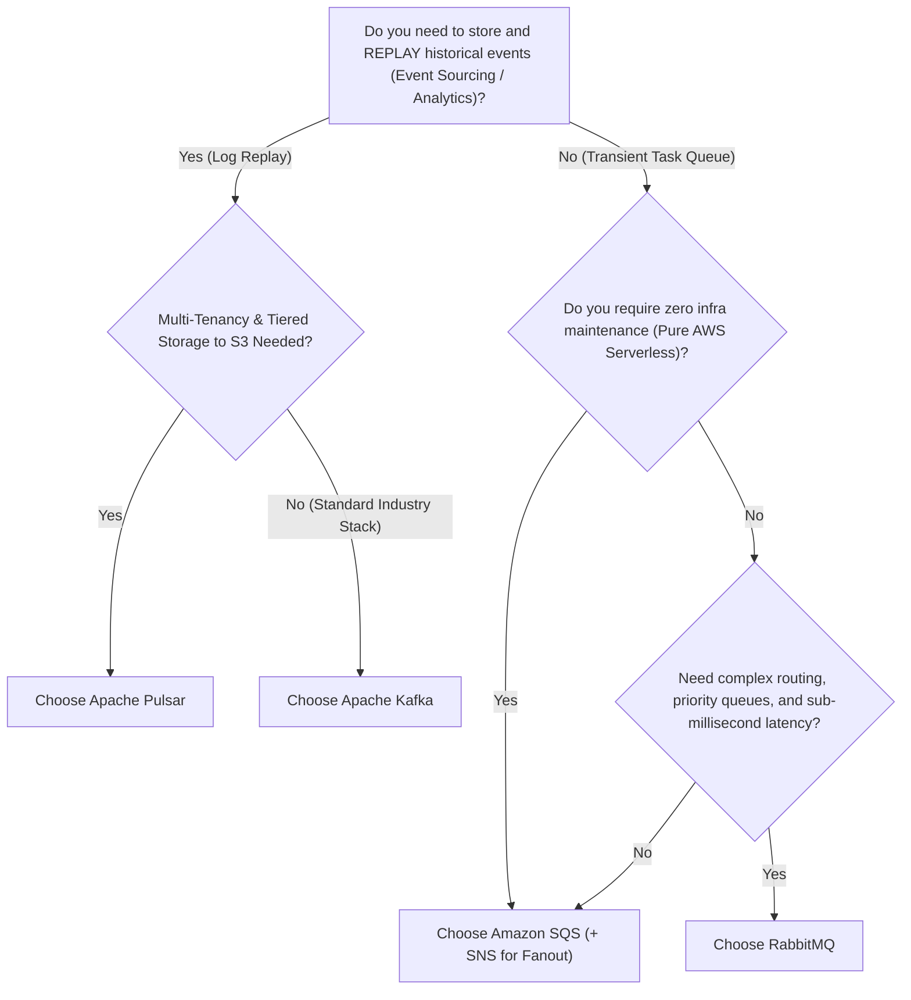

## 1. Executive Summary & Shared Criteria Decision Matrix

Message brokers and streaming platforms decouple asynchronous systems, smooth traffic spikes, and buffer work. However, they embody fundamentally different architectural paradigms: **Smart Broker / Dumb Consumer** (RabbitMQ, SQS) versus **Dumb Broker / Smart Consumer (Distributed Log)** (Kafka, Pulsar).

| Evaluation Criteria | Apache Kafka | RabbitMQ | Amazon SQS | Apache Pulsar |
| :--- | :--- | :--- | :--- | :--- |
| **Architectural Model** | Distributed Append-Only Log | AMQP Message Broker | Cloud Managed Queue | Multi-tier Log (BookKeeper) |
| **Primary Consumption Model** | Pull (Consumer polling) | Push (Worker connections) | Pull (HTTP Long-poll) | Unified Streaming + Queue |
| **Throughput (Events/sec)** | **Extremely High** (Millions/sec) | Medium (10k–100k/sec) | High (Auto-scaled) | **Very High** (Millions/sec) |
| **End-to-End Latency** | Low (~2–10 ms) | **Ultra-Low (< 1 ms)** | Moderate (~10–30 ms) | Low (~2–5 ms) |
| **Message Replay** | **Yes** (Arbitrary offsets) | No (Deleted after ACK) | No (Deleted after ACK) | **Yes** (Long-term retention) |
| **Ordering Guarantee** | Per Partition strictly | Per Queue strictly | FIFO queues only (3k/s) | Per Partition strictly |
| **Complex Routing** | Basic (Topic partitions) | **Advanced** (AMQP Exchanges) | Basic (SNS Fan-out) | Advanced (Key_Shared) |
| **Operational Overhead** | High (Cluster, KRaft/ZK) | Medium (Erlang, clustering)| **Zero** (Serverless AWS) | High (BookKeeper + ZK) |

---

## 2. Decision Flowchart

---

## 3. When Each Technology Wins

### When Apache Kafka Wins
- **High-Volume Event Streaming**: Clickstreams, telemetry, log ingestion, and financial ticker pipelines processing hundreds of gigabytes per hour.
- **Event-Driven Architectures & CQRS**: Multiple independent consumer microservices reading the same stream at their own pace without impacting each other.
- **Stream Processing**: Tight integration with Kafka Streams, Apache Flink, and Apache Spark.

### When RabbitMQ Wins
- **Complex Transactional Routing**: Uses topic wildcards (`order.*.created`) and header exchanges to dynamically route messages to specific queues.
- **Priority Queuing**: Jobs must be processed strictly according to priority flags (e.g. VIP payments ahead of standard background jobs).
- **Transient Worker Task Queues**: Tasks are consumed once, acknowledged, and immediately discarded from memory.

### When Amazon SQS Wins
- **Cloud-Native Simplicity (Zero Ops)**: No servers to provision, patch, monitor, or size. Highly resilient out of the box across three Availability Zones.
- **Bursty Background Asynchronous Jobs**: Email sending, document PDF rendering, and webhook retries with built-in dead-letter queues (DLQ).

### When Apache Pulsar Wins
- **Multi-Tenant Enterprise Clouds**: Native tenant and namespace isolation with bandwidth quotas.
- **Tiered Cold Storage**: Automatically offloads aged partition data from expensive local SSDs to cheap Amazon S3 without breaking streaming consumers.

---

## 4. Hidden Costs & Operational Traps

1. **Kafka Rebalancing Storms**:
   In older or misconfigured Kafka consumer groups, if a consumer encounters a long GC pause, the coordinator marks it dead and triggers a cluster-wide **stop-the-world rebalance**, stalling consumption across all partitions.
2. **RabbitMQ Memory Exhaustion**:
   RabbitMQ stores messages in RAM by default. If consumers lag and queues swell to millions of unread messages, RabbitMQ page-faults to disk, causing throughput to collapse precipitously.
3. **Amazon SQS API Billing at Scale**:
   SQS charges $0.40 per 1 million API requests. Empty polling loops making continuous short-polls can trigger multi-thousand-dollar monthly AWS bills for idle queues. (Always enable `ReceiveMessageWaitTimeSeconds = 20` for long-polling!).

---

## 5. Migration Paths

- **Migrating from SQS to Kafka**: Required when moving to multi-cloud or when cross-service event replay becomes mandatory. Wrap message payloads in schema-evolved JSON or Protobuf.
- **Migrating from RabbitMQ to Pulsar**: Pulsar supports native AMQP compatibility (Pulsar-on-RabbitMQ) allowing legacy queues to transition while unlocking multi-partition scale.

---

## 6. Interview Corner

### [Basic] What is the fundamental difference between Kafka and RabbitMQ?
**Model Answer**: RabbitMQ is a message broker where messages are pushed to workers and destroyed immediately once acknowledged. Kafka is an immutable, partitioned append-only distributed commit log where messages are retained on disk for a configured TTL (e.g. 7 days), and consumers pull records by tracking their own offset pointers.

### [Intermediate] How does Amazon SQS handle duplicate message delivery?
**Model Answer**: Standard SQS queues guarantee *at-least-once* delivery, meaning occasional duplicate messages will occur due to distributed lock timeouts. Systems must design consumer handlers to be **idempotent** (e.g., using database unique constraints or idempotency keys). Alternatively, SQS FIFO queues guarantee exactly-once processing with deduplication IDs, but are capped at 3,000 requests/second with batching.

### [Advanced] What happens in Kafka when consumer group partition count exceeds consumer instance count?
**Model Answer**: If a topic has 6 partitions and a consumer group has 3 instances, Kafka's group coordinator assigns 2 partitions to each consumer. If you scale the consumer group to 8 instances, 6 instances will each process 1 partition, and 2 consumer instances will sit completely idle. A single partition can never be read concurrently by more than one consumer in the same group.
