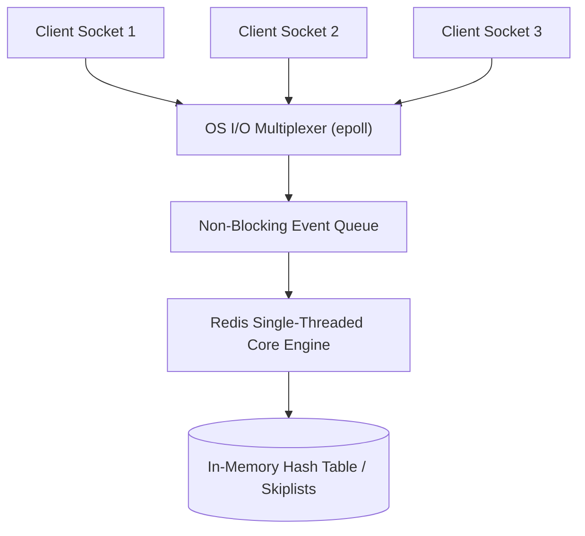
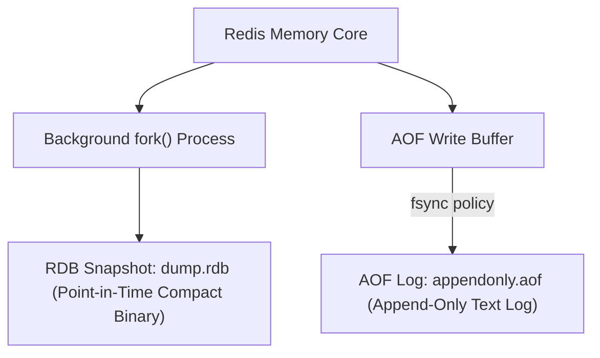
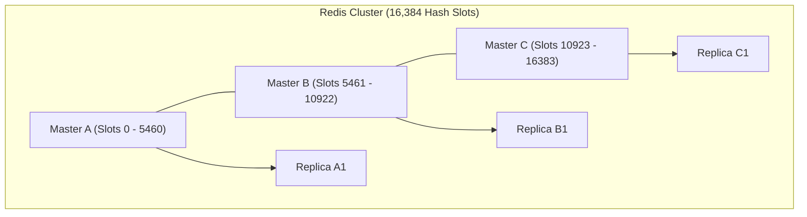

## 1. What It Is & When to Use

Redis (Remote Dictionary Server) is an open-source, in-memory key-value data structure store used as a database, cache, message broker, and streaming engine.

### When to Use:
- Sub-millisecond read/write latency requirements (< 1ms p99).
- Ephemeral session caching and distributed rate limiting.
- High-concurrency leaderboard rankings via Sorted Sets (ZSET).
- Distributed locking primitives with short expiration TTLs.
- Pub/Sub broadcasting and lightweight message queuing.

### When NOT to Use:
- Datasets exceeding available server RAM (unless using Redis on Flash or Tiered Memory).
- Complex ad-hoc multi-table relational joins or OLAP analytical scans.
- Primary storage where zero-data-loss RPO = 0 is mandatory across catastrophic power losses.

---

## 2. Architecture: The Single-Threaded Event Loop

A common interview question: *"How is Redis so fast if it only uses one thread?"*

Redis executes all client read and write commands on a **single main execution thread**. It achieves 100,000+ operations/sec per core because:
1. **Pure In-Memory Operations**: Lookups and modifications happen directly in RAM (latencies ~100ns), avoiding disk seek bottlenecks.
2. **Zero Lock Contention**: No mutex locks, spinlocks, or thread context switching overhead.
3. **I/O Multiplexing (Reactor Pattern)**: Uses OS-level non-blocking polling (`epoll` on Linux, `kqueue` on macOS) to handle tens of thousands of idle client sockets on one thread.

> [!NOTE]
> Starting in Redis 6.0, Redis introduced multi-threaded I/O for network read/write socket parsing, but command execution remains strictly single-threaded and serialized.

---

## 3. Rich Data Model & Under-the-Hood Encodings

Redis does not just store strings; it supports sophisticated data structures with memory-efficient internal encodings:

1. **Strings**: Binary-safe up to 512 MB. Uses SDS (Simple Dynamic String) with pre-allocated buffer headers to achieve $O(1)$ length lookups.
2. **Hashes**: Field-value pairs. Encoded as compact `ziplist` (flat byte array) for small maps; upgrades to a full `hashtable` (Dict) when fields exceed 512.
3. **Lists**: Doubly-linked sequences. Implemented via `quicklist` (a linked list of ziplists) optimizing cache line locality.
4. **Sets**: Unordered unique strings. Encoded as an `intset` for pure integer collections; upgrades to a hash table.
5. **Sorted Sets (ZSET)**: Each string member has a floating-point score. Implemented via a dual **Hash Table + Skip List** ($O(\log N)$ inserts and range scans).
6. **Bitmaps & HyperLogLog**: Bit-level operations and probabilistic unique cardinality counters ($1.5\text{ KB}$ memory to count 2 billion items with $\approx 0.81\%$ error).
7. **Streams**: Append-only log with consumer groups inspired by Apache Kafka.

---

## 4. Internals: Persistence, Replication & High Availability

### Persistence: RDB vs AOF

1. **RDB (Redis Database Snapshotting)**:
   - Takes point-in-time binary snapshots of all RAM.
   - Uses OS `fork()` to create a child process with Copy-on-Write (COW).
   - Fast to restore; compact storage.
   - *Downside*: Data written since the last snapshot (e.g. last 5 minutes) is lost on crash.
2. **AOF (Append-Only File)**:
   - Logs every write command (`SET`, `INCR`) sequentially to disk.
   - Configurable `fsync` policies:
     - `appendfsync always`: fsync after every write (slowest, zero data loss).
     - `appendfsync everysec`: fsync once per second (**production gold standard**, loses at most 1 second of data).
     - `appendfsync no`: delegates to OS kernel buffers.

---

### High Availability: Redis Sentinel vs Redis Cluster

- **Redis Sentinel**: Best for smaller single-master setups (up to a few tens of GBs). Monitors Master, handles automated failover to Replica, and notifies clients via Pub/Sub.
- **Redis Cluster**: Shards data horizontally across up to 1,000 nodes.
  - Divides key space into exactly **16,384 hash slots**.
  - `Slot = CRC16(key) mod 16384`.
  - Clients cache the slot map locally; if a key moves, Redis returns a `-MOVED 3999 10.0.0.2:6379` redirect.

---

## 5. Operations & Scaling

- **Memory Eviction Policies (`maxmemory-policy`)**:
  - `noeviction`: Returns errors on writes when memory is full.
  - `allkeys-lru`: Evicts least-recently-used keys across all keys (**best for pure caches**).
  - `volatile-lru`: Evicts LRU keys only among those with an active TTL set.
  - `allkeys-lfu`: Evicts least-frequently-used keys.

---

## 6. Failure Modes & Latency Pitfalls

1. **The Dangerous `KEYS *` Command**:
   Running `KEYS user:*` scans the entire hash table. Because Redis is single-threaded, this command blocks all other production traffic for seconds or minutes!
   - *Fix*: Strictly disable `KEYS` in production and use `SCAN` with a cursor.
2. **Big Keys (Huge Blobs)**:
   Deleting a single ZSET or List with 1,000,000 elements causes the main thread to stall while freeing memory.
   - *Fix*: Use `UNLINK` instead of `DEL` (frees memory asynchronously on a background worker thread).
3. **Copy-on-Write (COW) Memory Spike During `fork()`**:
   When taking an RDB snapshot or AOF rewrite, if the database experiences heavy write traffic, OS Copy-on-Write duplicates memory pages, causing the server to consume 2x RAM and OOM crash.

---

## 7. Tuning Knobs

- `appendfsync everysec`: Optimal balance of throughput and durability.
- `tcp-backlog 511`: Prevents dropped connections under SYN flood spikes.
- `activedefrag yes`: Compacts fragmented memory without restarting the process.

---

## 8. Limits & Gotchas

- Key size limit: 512 MB (in practice, keep keys $< 1\text{ KB}$).
- Value size limit: 512 MB (in practice, keep values $< 50\text{ KB}$ to avoid network serialization stalls).

---

## 9. When NOT to Use & Alternatives

- Use **Memcached** when you only need simple multi-threaded key-value caching without data structures or persistence.
- Use **PostgreSQL / DynamoDB** when ACID transactions across arbitrary tables are required.
- Use **DragonflyDB / KeyDB** if you want drop-in Redis API compatibility utilizing all multi-core CPU threads natively.

---

## 10. Interview Corner

### [Basic] How does Redis achieve data persistence?
**Model Answer**: Redis provides two persistence mechanisms: RDB (point-in-time binary snapshots generated via background `fork()`) and AOF (an append-only log of every write command). Production deployments typically enable both, using `appendfsync everysec` for minimal data loss and RDB for rapid disaster recovery restores.

### [Intermediate] How does Redis Cluster route keys to nodes?
**Model Answer**: Redis Cluster divides the entire keyspace into 16,384 virtual hash slots. Keys are hashed using `CRC16(key) mod 16384`. Each master node is assigned a subset of slots. Smart client SDKs cache this slot map; if a key is accessed on the wrong node, the node responds with a `-MOVED <slot> <ip:port>` redirect, prompting the client to update its route table.

### [Advanced] What causes latency spikes in Redis and how do you diagnose them?
**Model Answer**: Latency spikes are diagnosed using `LATENCY DOCTOR` and `SLOWLOG GET 10`. Common root causes include:
1. Long-running $O(N)$ commands (`KEYS`, `HGETALL` on large hashes).
2. Large memory allocation or synchronous `DEL` on big keys (fix: `UNLINK`).
3. Memory swapping caused by system RAM exhaustion.
4. Transparent Huge Pages (THP) kernel latency during fork (fix: disable THP in Linux OS).
